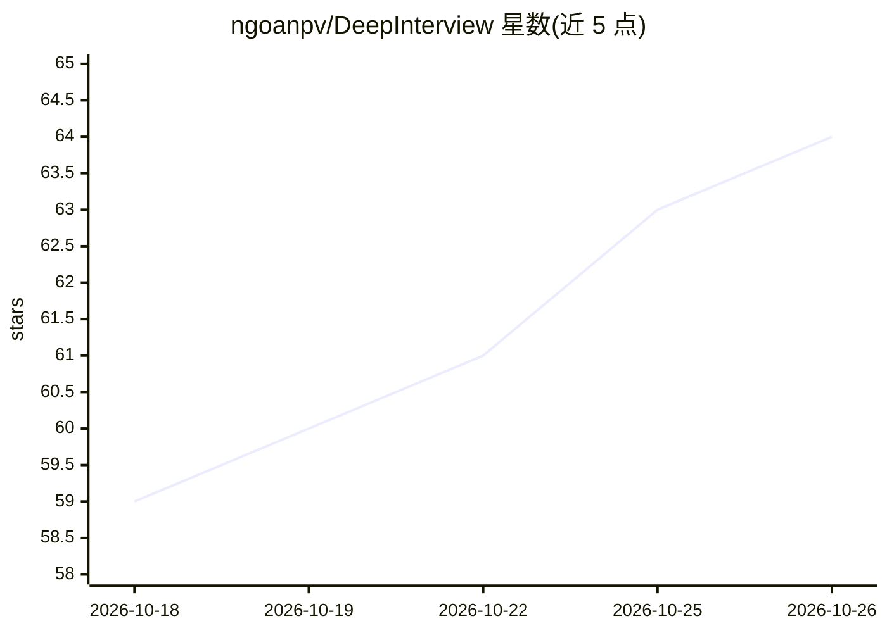

# ngoanpv/DeepInterview

⭐ 64 · Python · Apache-2.0 · 推送 2026-10-13 · [GitHub](https://github.com/ngoanpv/DeepInterview) · [官网](https://deepinterview) · 个人维护

**开源自托管的语音 AI 模拟面试官：练口语并评分辅导**

面向求职者的语音优先模拟面试应用：面试前由 LangGraph 流水线读取简历与职位描述（CV/JD）、调研公司并预生成问题计划与评分标准；面试中在 LiveKit 上以 STT→LLM→TTS 级联实时对话（支持打断、语义轮次检测、自适应追问）；面试后输出分能力评分卡与针对弱项的学习教练。各阶段供应商可经环境变量替换，无 key 时回退 mock 适配器离线运行；可全部本地运行（Ollama+Whisper+Kokoro）。自托管无需登录，Apache 2.0。限制：实时语音与视频头像仍需供应商 key，本地延迟未基准测试。

## 筛选速览

| 维度 | 判定 | 备注 |
|---|---|---|
| AI 角色 | `ai-native` | 本体是模型或模型工具 |
| 许可风险 | `permissive` | Apache-2.0 |
| 部署形态 | `self-host` | docker 或自建部署 |
| 模型依赖 | local-ok | 支持本地模型 |
| 硬件要求 | — | 无带数字的原话,不猜 |
| 安装摩擦 | `low` | 无编译、无系统依赖或容器化 |
| 成熟度 | `idea` | |

## 能力要点

- 面试前 CV/JD 解析 + 公司调研 + 问题计划与评分标准预计算
- LiveKit 上 STT→LLM→TTS 实时语音面试，支持 7 种语言
- 分能力 rubric 评分卡与针对弱项的 Prep Coach 学习循环
- 各组件可换供应商或 100% 本地运行（Ollama/Whisper/Kokoro），无 key 时用 mock 适配器离线运行

## 适用场景

- 求职者对着真实 JD 用语音练习面试并获得评分反馈
- 完全本地部署面试练习环境，简历不出本机
- 社区以题目包和语言包形式贡献面试内容

## 场景标签

`语音 Agent` · 领域:对话与助手

## 证据(README 行号)

> L26: > **Upload your CV and a job description. Talk to an AI interviewer. Get scored — and coached on exactly what you m
> L28: DeepInterview closes the **prep ⇄ interview ⇄ feedback** loop: heavy reasoning runs *before* the call (read your CV
> L84: - **A real conversation, not a form** — a cascaded **STT → LLM → TTS** loop on LiveKit with barge-in, semantic end-

## 星数曲线

2026-10-18 59 → 2026-10-26 64（+5）

---
*卡片 v1 · prompt 1.4 · 生成 2026-10-24 · 置信度 high · 依据 README sha `b26ee0b03d9b` · [字段定义](../../DATASET.md)*
