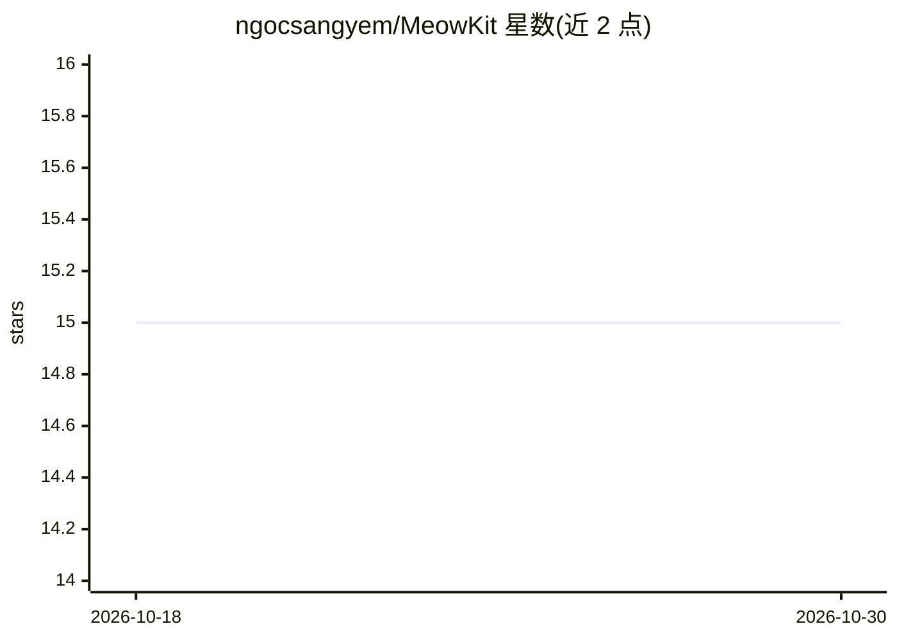

# ngocsangyem/MeowKit

⭐ 15 · TypeScript · MIT · 推送 2026-07-27 · [GitHub](https://github.com/ngocsangyem/MeowKit) · [官网](https://docs.meowkit.dev/) · 个人维护

**为 Claude Code 安装结构化工作流的 AI agent 工具包**

MeowKit 通过 npm CLI 或 Claude Code 插件市场安装一个 .claude/ 目录，向 Claude Code 会话注入 128 个技能、42 个 agent、27 个命令、27 条规则与 18 个 hook 脚本，强制执行 7 阶段工作流（含硬性关卡、TDD、安全扫描与主题文件记忆）。核心工作流零外部依赖；Python 技能另需 npx mewkit setup 创建 venv。对 Codex 的支持为实验性投影，hook 强制在 Codex 上仅为建议性，且提供技能一致性（parity）评分与迁移校验命令。要求 Node.js 20+、Python 3.9+、Git。

## 筛选速览

| 维度 | 判定 | 备注 |
|---|---|---|
| AI 角色 | `ai-ecosystem` | LLM/agent 周边工具 |
| 许可风险 | `permissive` | MIT |
| 部署形态 | `library` | 以包/库形式分发 |
| 模型依赖 | — | README 未给出锁定关系 |
| 硬件要求 | — | 无带数字的原话,不猜 |
| 安装摩擦 | `low` | 无编译、无系统依赖或容器化 |
| 成熟度 | `idea` | |

## 能力要点

- 128 skills、42 agents、18 hook 脚本的 .claude/ 目录脚手架
- 7 阶段工作流硬关卡 + TDD + 安全扫描 + 主题文件记忆
- Codex 迁移为 default-deny，附带机器验证的结构性 parity 评分与 mewkit validate 校验
- 提供 mewkit CLI（init/doctor/validate/budget/memory）

## 适用场景

- 给 Claude Code 项目配置强制性的结构化开发工作流
- 在 Codex 上以建议模式复用部分技能并校验迁移结果
- 用专题记忆文件（fixes.md 等）沉淀项目知识

## 场景标签

`工作流自动化` `Agent 框架` · 领域:Agent 开发

## 证据(README 行号)

> L5:  AI agent toolkit for Claude Code
> L16: MeowKit installs a `.claude/` directory that Claude Code reads at session start. It enforces a structured 7-phase w
> L33: ### Native plugin (recommended on Claude Code; experimental on Codex)

## 星数曲线

2026-10-18 15 → 2026-10-30 15（+0）

---
*卡片 v1 · prompt 1.4 · 生成 2026-10-30 · 置信度 high · 依据 README sha `41da4531f290` · [字段定义](../../DATASET.md)*
