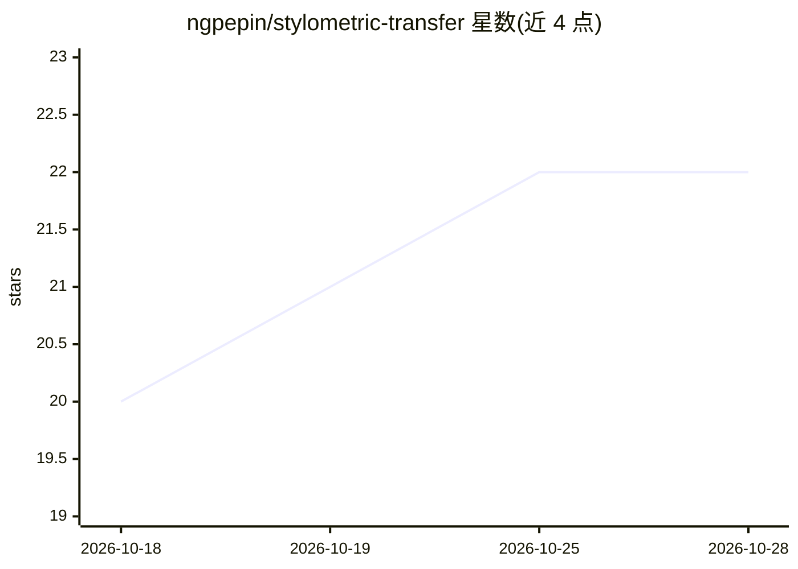

# ngpepin/stylometric-transfer

⭐ 22 · Python · NOASSERTION · 推送 2026-07-07 · [GitHub](https://github.com/ngpepin/stylometric-transfer) · 个人维护

**基于作者语料指纹的文风画像与文风迁移工具**

两阶段流水线：先从作者写作档案（zip/tar，支持 txt/md/rst/html/docx）提取可解释的 JSON 风格指纹，包含句长分布、标点频率、功能词、立场信号等本地统计测量；再通过 LLM 按指纹约束改写 Markdown 文本以保持原意并匹配文风，附带确定性后处理、偏差报告与可选的合规重试。含本地 HTTP API（make/apply/rate/similarity）、HTML 指纹仪表盘与 GUI 调用示例。兼容任意 OpenAI 兼容端点（OpenAI、Azure OpenAI、vLLM 等）。采用 PolyForm Noncommercial 非商业许可证。

## 筛选速览

| 维度 | 判定 | 备注 |
|---|---|---|
| AI 角色 | `ai-native` | 本体是模型或模型工具 |
| 许可风险 | `none` | NOASSERTION |
| 部署形态 | `library` | 以包/库形式分发 |
| 模型依赖 | local-ok | 支持本地模型 |
| 硬件要求 | — | 无带数字的原话,不猜 |
| 安装摩擦 | `low` | 无编译、无系统依赖或容器化 |
| 成熟度 | — | 结构信号不足 |

## 能力要点

- 从语料提取显式、可编辑、可版本化的 JSON 风格指纹
- LLM 约束驱动的文风迁移，保持原意并输出偏差报告
- 本地 HTTP API（make/apply/rate/similarity）与 HTML 指纹仪表盘
- humanizer 规则与指纹约束的冲突消解层

## 适用场景

- 让 LLM 用我的写作风格改写或生成文本
- 构建并审阅个人写作风格的可解释画像
- 通过本地 API 集成文风指纹的生成与相似度比较

## 场景标签

`AI 写作` · 领域:内容生成

## 证据(README 行号)

> L7: In practical terms, the system enables an LLM to apply a specified writing style to any text input. It performs styl
> L39:  Rewriting new text to conform to that fingerprint while preserving meaning

## 星数曲线

2026-10-18 20 → 2026-10-28 22（+2）

---
*卡片 v1 · prompt 1.4 · 生成 2026-10-27 · 置信度 mid · 依据 README sha `8d79e649892b` · [字段定义](../../DATASET.md)*
