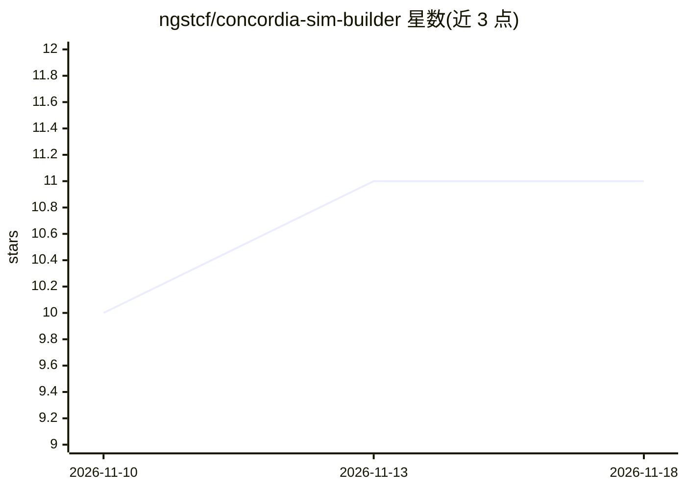

# ngstcf/concordia-sim-builder

⭐ 11 · HTML · Apache-2.0 · 推送 2026-10-23 · [GitHub](https://github.com/ngstcf/concordia-sim-builder) · [官网](https://c3.unu.edu/projects/ai/simulator) · 组织维护

**给社科研究者提供无代码 Web UI 来配置和运行 LLM 多智能体社会仿真**

基于 Google DeepMind Concordia 库的 Web 界面，通过表单和下拉菜单配置智能体、心理组件与场景，无需编写 Python。运行由 LLM 驱动的仿真，提供播放/暂停/步进控制、SSE 实时日志、9 标签分析仪表盘、AI 分析报告与 CSV/JSON 导出。支持 39 个模板、基于人口分布的批量智能体生成、温度参数扫描、检查点恢复与续跑。API key 通过 .env 或 UI 输入，状态文件不保存密钥。

## 筛选速览

| 维度 | 判定 | 备注 |
|---|---|---|
| AI 角色 | `ai-native` | 本体是模型或模型工具 |
| 许可风险 | `permissive` | Apache-2.0 |
| 部署形态 | `library` | 以包/库形式分发 |
| 模型依赖 | local-ok | 支持本地模型 |
| 硬件要求 | — | 无带数字的原话,不猜 |
| 安装摩擦 | `low` | 无编译、无系统依赖或容器化 |
| 成熟度 | — | 结构信号不足 |

## 能力要点

- 表单式配置替代 1,100–7,000+ 行 Python 场景代码
- 39 个预置仿真模板，含 5 个 DeepMind 上游示例改编
- 检查点自动保存，可从任意中断点恢复或追加步数续跑
- 8 种 LLM Provider 接入，Game Master 可独立选模型

## 适用场景

- 研究疫苗犹豫、网络钓鱼、城市士绅化等社会场景的智能体仿真
- 按人口分布批量生成智能体并做参数扫描实验
- 对博弈论与社会困境场景（公地悲剧、囚徒困境）做教学实验
- 长时仿真中断后从检查点恢复或扩展运行步数

## 场景标签

`多智能体` `科研工具` · 领域:Agent 开发

## 证据(README 行号)

> L3: A web interface for Google DeepMind's Concordia library that makes running agent-based social simulations accessible
> L5: Configure agents, psychological components, and scenarios through forms. Run simulations powered by LLMs. Analyze re
> L99: - **8 LLM Providers** — OpenAI, Azure OpenAI (up to two endpoints), DeepSeek, Anthropic, Gemini, GLM, Ollama Local,

## 星数曲线

2026-11-10 10 → 2026-11-18 11（+1）

---
*卡片 v1 · prompt 1.4 · 生成 2026-11-18 · 置信度 high · 依据 README sha `91bf87418930` · [字段定义](../../DATASET.md)*
