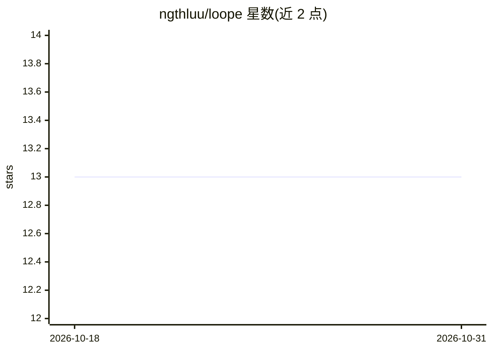

# ngthluu/loope

⭐ 13 · Go · MIT · 推送 2026-08-23 · [GitHub](https://github.com/ngthluu/loope) · 个人维护

**给开发者：给 GitHub issue 打标签，自动驱动生成 PR 的守护进程**

用 Go 编写的无状态守护进程，监控带 ai-agent 标签的 GitHub issue，调用 headless Claude Code 将其转化为带审查与人工核验清单的 pull request。机制上使用 git worktree 隔离各任务，含架构师 agent 与产品负责人 agent 的设计辩论环节、置信度门槛（模糊 issue 先提问）、失败自动搁置不重试；支持多机器多账号共享同一 issue 面板的舰队模式，提供实时 dashboard 展示每步 token 与成本。以单个 Go 二进制分发，需自备 git、gh 与 claude。

## 筛选速览

| 维度 | 判定 | 备注 |
|---|---|---|
| AI 角色 | `ai-ecosystem` | LLM/agent 周边工具 |
| 许可风险 | `permissive` | MIT |
| 部署形态 | `None` |  |
| 模型依赖 | — | README 未给出锁定关系 |
| 硬件要求 | — | 无带数字的原话,不猜 |
| 安装摩擦 | `low` | 无编译、无系统依赖或容器化 |
| 成熟度 | — | 结构信号不足 |

## 能力要点

- 标签触发：issue 打 ai-agent 标签即进入自动化流程
- git worktree 任务隔离，无状态守护进程，无队列/数据库/协调器
- 失败搁置机制：限流/预算耗尽/崩溃后带完整错误停放，不自动重试
- 舰队模式与 dashboard：多机器多账号，展示每步 token 成本

## 适用场景

- 给 GitHub issue 打标签自动产出待审查的 PR
- 多台机器和多个 Claude Code 账号并行处理 issue
- 通过 dashboard 追踪各 worker 的用量与成本

## 场景标签

`编码 Agent` `多智能体` · 领域:Agent 开发

## 证据(README 行号)

> L8: An always-on loop that turns your issues into reviewed PRs with Claude Code — with no infrastructure to run.
> L32: One Go binary for macOS and Linux. Bring your own `git`, `gh` and `claude` — nothing else to run.

## 星数曲线

2026-10-18 13 → 2026-10-31 13（+0）

---
*卡片 v1 · prompt 1.4 · 生成 2026-10-31 · 置信度 high · 依据 README sha `b8c3fd3839a9` · [字段定义](../../DATASET.md)*
