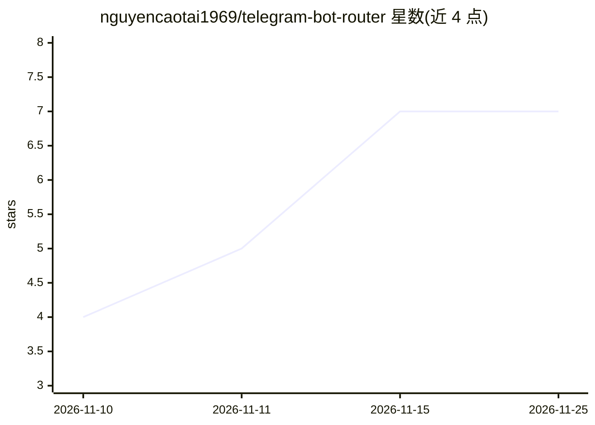

# nguyencaotai1969/telegram-bot-router

⭐ 7 · TypeScript · MIT · 推送 2026-11-16 · [GitHub](https://github.com/nguyencaotai1969/telegram-bot-router) · 个人维护

**让开发者通过 Telegram 群话题远程操控本机 Claude Code**

基于 Bun 与 TypeScript 的路由程序：一个 Telegram 机器人、一个开启 Topics 的群，每个话题绑定一个项目文件夹，消息驱动对应文件夹内的 Claude Code 执行任务并在同话题回复。支持每话题独立会话与模型选择、任务进行中追加消息、图片/文件双向传输、后台任务完成通知、会话体量告警与服务器迁移向导。要求本机已安装并登录 Claude Code、Bun ≥ 1.3，机器人以 --dangerously-skip-permissions 运行，依赖用户 ID/群 ID 白名单与密钥文件过滤控制风险。

## 筛选速览

| 维度 | 判定 | 备注 |
|---|---|---|
| AI 角色 | `ai-native` | 本体是模型或模型工具 |
| 许可风险 | `permissive` | MIT |
| 部署形态 | `desktop` | 安装包/桌面程序 |
| 模型依赖 | — | README 未给出锁定关系 |
| 硬件要求 | — | 无带数字的原话,不猜 |
| 安装摩擦 | `low` | 无编译、无系统依赖或容器化 |
| 成熟度 | — | 结构信号不足 |

## 能力要点

- 一个话题绑定一个项目文件夹，各自维护独立 Claude 会话与记忆
- 任务进行中可继续发消息，内容注入正在运行的任务
- 图片与文件双向传输：发送截图/文档给 Claude，Claude 以 📎 行回传文件
- 内置 /server 服务器迁移向导，密码即时删除且存于本地 .env.servers

## 适用场景

- 手机上远程给各项目下达编码任务并跟踪进度
- 在群话题里给 Claude 发截图并要求修复布局问题
- 通过 Telegram 话题分步完成服务器间迁移操作

## 场景标签

`编码 Agent` · 领域:编码与开发

## 证据(README 行号)

> L10: **Control Claude Code from your phone.** One Telegram bot, one group with Topics: **each topic is one project**. Wr
> L16: - 🗂️ **One topic = one project folder**, each with its own Claude session and memory of the conversation.
> L138: Claude runs with `--dangerously-skip-permissions`: it runs commands and edits files **without asking**. Anyone who

## 星数曲线

2026-11-10 4 → 2026-11-25 7（+3）

---
*卡片 v1 · prompt 1.4 · 生成 2026-11-20 · 置信度 high · 依据 README sha `67fe9dd19c9b` · [字段定义](../../DATASET.md)*
