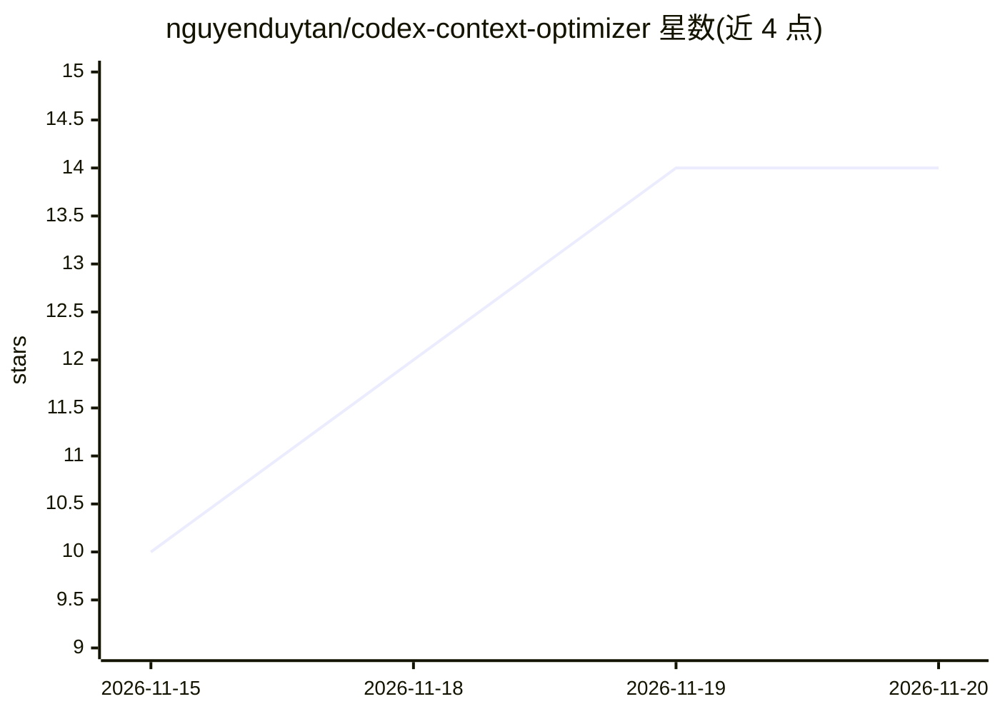

# nguyenduytan/codex-context-optimizer

⭐ 14 · Rust · MIT · 推送 2026-10-15 · [GitHub](https://github.com/nguyenduytan/codex-context-optimizer) · 个人维护 · 中文 README

**为 Codex CLI 本地编译上下文与执行预算的开发者工具**

Rust 编写的 CLI 工具（ctxc），将编码任务编译为可检查的执行契约：保护否定/路径/字面量等显式约束，选取相关上下文、去重、按 token 预算裁剪，再通过 Codex 适配器启动一次 Codex 运行。编译过程在本地完成，无第二次模型调用、无 API key 与遥测；v0.1 仅针对 Codex CLI，token 估算为近似值。安装提供源码构建（Rust 1.98+）、原生二进制安装脚本与 cargo registry。

## 筛选速览

| 维度 | 判定 | 备注 |
|---|---|---|
| AI 角色 | `ai-ecosystem` | LLM/agent 周边工具 |
| 许可风险 | `permissive` | MIT |
| 部署形态 | `library` | 以包/库形式分发 |
| 模型依赖 | — | README 未给出锁定关系 |
| 硬件要求 | — | 无带数字的原话,不猜 |
| 安装摩擦 | `low` | 无编译、无系统依赖或容器化 |
| 成熟度 | `idea` | |

## 能力要点

- 本地编译执行契约，保护显式约束不被改写
- 上下文预算控制与 8 KiB 有界项目地图
- 按任务类型（CHAT/MICRO/CODE/COMPLEX）应用默认策略
- 支持 --mode/--effort/--budget 等 CLI 选项与 JSON 结构化输出

## 适用场景

- 在 Codex CLI 运行任务前控制上下文与 token 预算
- 保留任务中的否定与 API 约束不被优化破坏
- 审查每次运行的契约、决策追踪与用量元数据

## 场景标签

`提示工程` · 领域:Agent 开发

## 证据(README 行号)

> L13:  A local-first context compiler and execution-budget governor for Codex and AI coding workflows.
> L15: `ctxc` builds an inspectable execution contract around your task, protects explicit constraints, selects relevant c
> L109: |`ctxc run <task>`|Compile and launch Codex once.|

## 星数曲线

2026-11-15 10 → 2026-11-20 14（+4）

---
*卡片 v1 · prompt 1.4 · 生成 2026-11-18 · 置信度 high · 依据 README sha `97a32914d748` · [字段定义](../../DATASET.md)*
