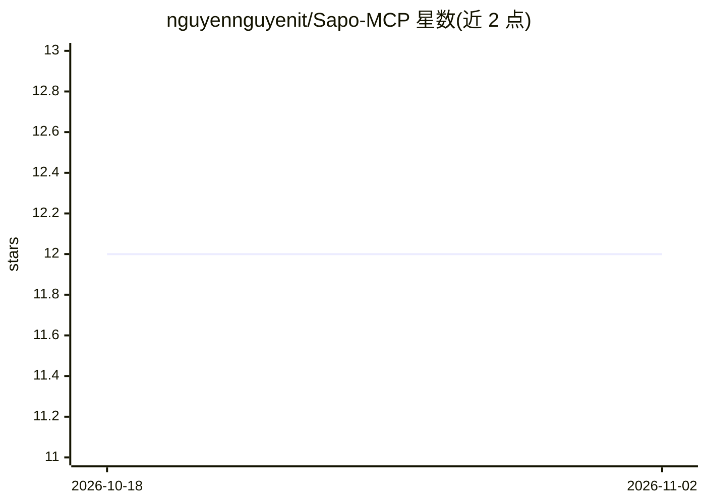

# nguyennguyenit/Sapo-MCP

⭐ 12 · TypeScript · MIT · 推送 2026-04-30 · [GitHub](https://github.com/nguyennguyenit/Sapo-MCP) · [官网](https://sapo-mcp-overview.pages.dev) · 个人维护 · 中文 README

**Sapo.vn POS/电商平台的 MCP 服务器：105 工具接入 AI 客户端**

面向 Sapo.vn 平台的 Model Context Protocol 服务器，将线上订单、客户、商品、库存、门店收银、SEO 与分析报表等操作封装为 105 个工具，分 4 种模式按需激活。支持 stdio（Claude Desktop、Cursor）与 Streamable HTTP（Docker/远程客户端）两种传输；单租户，需在 developers.sapo.vn 创建 Private App 获取凭据。破坏性操作默认封锁，须经 SAPO_ALLOW_OPS 白名单与 confirm:true 双重确认。处于 Pre-1.0 阶段，工具名与 schema 可能在小版本间变动；2 个 POS 班次工具因上游端点返回 HTML 被标记为损坏。

## 筛选速览

| 维度 | 判定 | 备注 |
|---|---|---|
| AI 角色 | `ai-ecosystem` | LLM/agent 周边工具 |
| 许可风险 | `permissive` | MIT |
| 部署形态 | `self-host` | docker 或自建部署 |
| 模型依赖 | — | README 未给出锁定关系 |
| 硬件要求 | — | 无带数字的原话,不猜 |
| 安装摩擦 | `low` | 无编译、无系统依赖或容器化 |
| 成熟度 | `idea` | |

## 能力要点

- 4 种模式共 105 个工具覆盖订单/库存/收银/SEO/分析
- 破坏性操作经 SAPO_ALLOW_OPS 白名单 + confirm:true 双重门控
- stdio 与 Streamable HTTP 双传输，HTTP 模式有会话隔离与空闲回收
- 工具验证分级（canary 监控/实测/仅文档/组合），每日 nightly 探测

## 适用场景

- 在 Claude Desktop 或 Cursor 中直接查询和管理 Sapo 店铺订单与库存
- 通过 AI 客户端生成营收、热销商品、LTV 等分析报表
- 以 Docker/HTTP 方式自托管，供远程 MCP 客户端接入

## 场景标签

 · 领域:电商/零售 AI 工具接入

## 证据(README 行号)

> L7: Model Context Protocol server for Sapo.vn POS & e-commerce platform.
> L12: - **Two transports:** stdio (Claude Desktop, Cursor) and Streamable HTTP (Docker, GoClaw)

## 星数曲线

2026-10-18 12 → 2026-11-02 12（+0）

---
*卡片 v1 · prompt 1.4 · 生成 2026-11-01 · 置信度 mid · 依据 README sha `c78c1e8860a1` · [字段定义](../../DATASET.md)*
