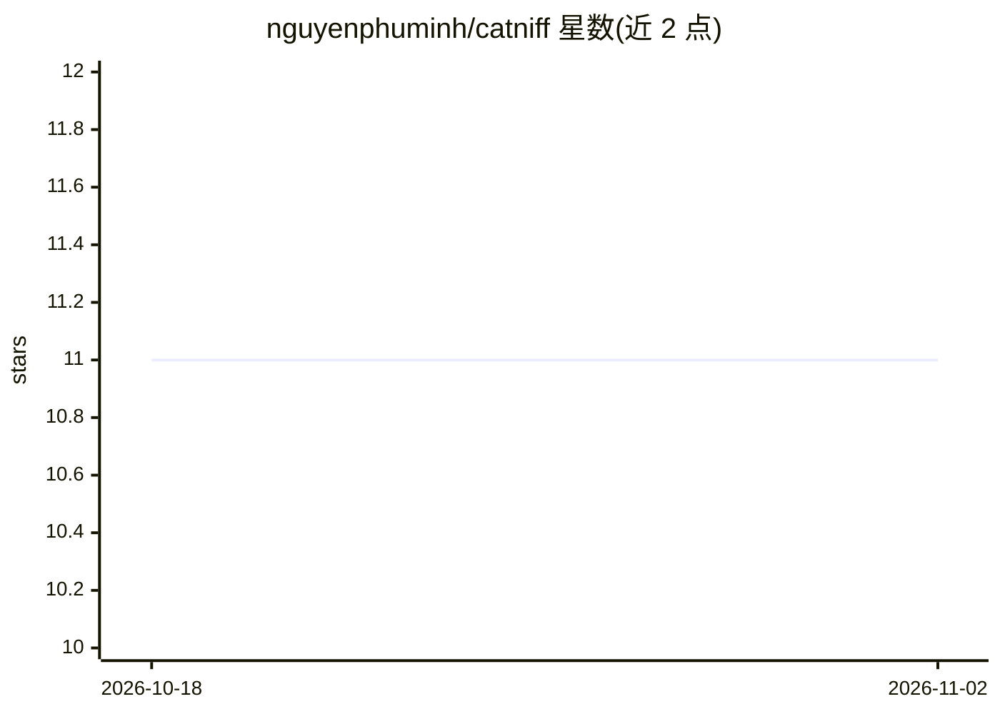

# nguyenphuminh/catniff

⭐ 11 · TypeScript · Apache-2.0 · 推送 2026-09-18 · [GitHub](https://github.com/nguyenphuminh/catniff) · 个人维护

**JavaScript 的类 Torch 深度学习框架：张量、自动微分与神经网络**

面向 JavaScript 开发者的小型深度学习框架，API 设计参考 Torch（灵感来自 Tinygrad）。提供 Tensor 张量运算、requiresGrad 自动梯度计算、内置优化器（Optim）与神经网络构造（nn 层、Embedding、归一化、Attention 等）。通过 npm 安装，建议 Node v24 以支持 float16，否则回退到 float32。项目处于开发中，API 可能不稳定且不向后兼容；GPU 加速仍在 Todo 列表。附文档与 Shakespeare 文本生成、XOR、N 阶导数等示例。

## 筛选速览

| 维度 | 判定 | 备注 |
|---|---|---|
| AI 角色 | `ai-native` | 本体是模型或模型工具 |
| 许可风险 | `permissive` | Apache-2.0 |
| 部署形态 | `library` | 以包/库形式分发 |
| 模型依赖 | — | README 未给出锁定关系 |
| 硬件要求 | — | 无带数字的原话,不猜 |
| 安装摩擦 | `medium` | 含编译或系统依赖之一 |
| 成熟度 | `idea` | |

## 能力要点

- Tensor 张量创建与张量算术运算
- requiresGrad 自动梯度计算
- 内置优化器与预置 nn 层（Linear、Embedding、归一化、Attention）
- npm 安装，建议 Node v24（float16，可回退 float32）

## 适用场景

- 在 JavaScript/Node 环境中原生搭建与训练神经网络
- 学习自动微分与深度学习底层机制
- 构建小型模型如文本生成（示例含 Shakespeare 风格生成器）

## 场景标签

`模型训练` · 领域:训练与推理

## 证据(README 行号)

> L3: Catniff is a small deep learning framework for Javacript, built to be Torch-like, originally inspired by Tinygrad AP
> L46: There are built-in neural network constructs in Catniff as well, from simple prebuilt nn layers:

## 星数曲线

2026-10-18 11 → 2026-11-02 11（+0）

---
*卡片 v1 · prompt 1.4 · 生成 2026-11-01 · 置信度 high · 依据 README sha `c449c9aaf0c8` · [字段定义](../../DATASET.md)*
