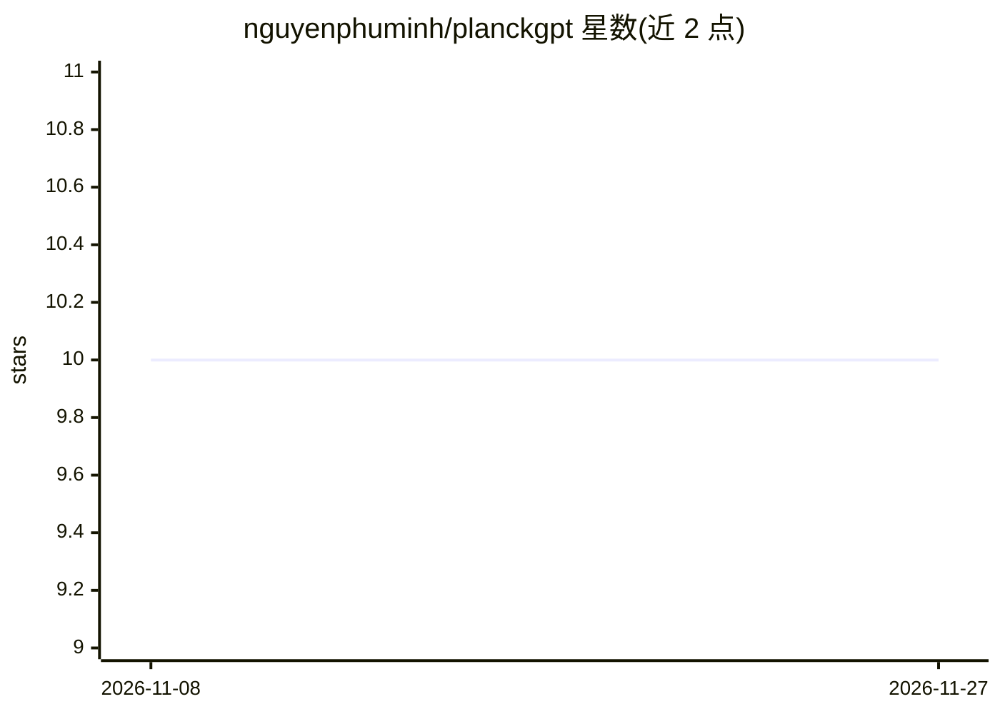

# nguyenphuminh/planckgpt

⭐ 10 · Python · Apache-2.0 · 推送 2026-11-07 · [GitHub](https://github.com/nguyenphuminh/planckgpt) · 个人维护

**在消费级笔记本上周末即可从零训练的 540M 参数 GPT**

作者个人实现的小型语言模型项目：约 540M 参数，在 Fineweb-edu 约 20 亿 token 上预训练，并可在 smol-smoltalk 上做通用对话微调。README 给出完整的预训练、微调、推理与评估脚本命令，训练配置（NorMuon 优化器、BF16 混合精度、torch.compile、梯度检查点等）针对 8GB 显存的 RTX 5070 Mobile 设计。预训练约 28 小时、对话微调约 4 小时，依赖 CUDA 环境与 venv 内安装 Python 包。

## 筛选速览

| 维度 | 判定 | 备注 |
|---|---|---|
| AI 角色 | `ai-native` | 本体是模型或模型工具 |
| 许可风险 | `permissive` | Apache-2.0 |
| 部署形态 | `desktop` | 安装包/桌面程序 |
| 模型依赖 | — | README 未给出锁定关系 |
| 硬件要求 | — | 无带数字的原话,不猜 |
| 安装摩擦 | `medium` | 含编译或系统依赖之一 |
| 成熟度 | — | 结构信号不足 |

## 能力要点

- 约 540M 参数、预训练约 2b Fineweb-edu token 的从零训练流水线
- 提供预训练/对话微调/推理/评估四类可配置脚本
- RoPE、RMSNorm、NorMuon、BF16、KV cache 等具体实现细节公开
- 模型权重可从 GitHub releases 或 Hugging Face 下载

## 适用场景

- 在单张消费级 GPU 上完整体验一次 LLM 预训练流程
- 在预训练权重上继续做对话微调实验
- 学习 GPT 架构与训练超参配置的参考实现

## 场景标签

`模型训练` `微调` · 领域:训练与推理

## 证据(README 行号)

> L3: PlanckGPT (planck length reference :D) is my attempt to make a tiny language model from scratch mostly for fun and e
> L5: The target of this project is achieving the best quality over training time possible, and I currently enforce a soft
> L71: * Tokenizer: Tiktoken with GPT-2 encoding (50,257 vocab size).

## 星数曲线

2026-11-08 10 → 2026-11-27 10（+0）

---
*卡片 v1 · prompt 1.4 · 生成 2026-11-19 · 置信度 high · 依据 README sha `ce17a23c109e` · [字段定义](../../DATASET.md)*
