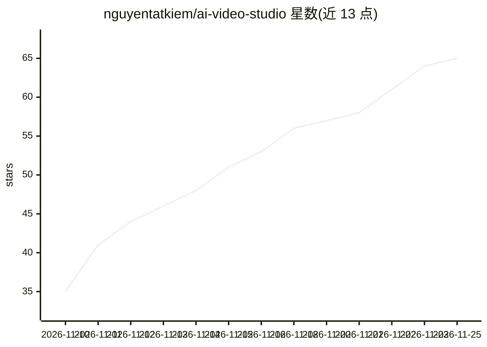

# nguyentatkiem/ai-video-studio

⭐ 65 · HTML · NOASSERTION · 推送 2026-11-12 · [GitHub](https://github.com/nguyentatkiem/ai-video-studio) · [官网](https://nguyentatkiem.com.vn/aiplusntk/) · 个人维护

**本地 AI 视频剪辑软件（macOS/Windows），面向短视频创作者**

运行于 macOS 与 Windows 的桌面视频编辑软件，面向 Reels/TikTok/YouTube Shorts 等短视频制作。提供 90 个带预览的模板、28 个风格包、约 200 个 HyperFrames 动画块；支持从任意视频克隆风格。AI 功能（AI 代剪、语音错误剪除、翻译配音、caption 生成、Telegram agent）通过 Claude Code CLI 实现，读取用户 Claude 账号登录，无需单独 API key；不装 Claude 时剪辑、模板与渲染功能仍可正常使用。批量处理从 Excel/CSV 读入，可自动发布至 YouTube。安装方式为 git clone 或 ZIP 下载后运行 install.sh/install.cmd。

## 筛选速览

| 维度 | 判定 | 备注 |
|---|---|---|
| AI 角色 | `ai-enhanced` | 去掉 AI 部分产品仍成立 |
| 许可风险 | `none` | NOASSERTION |
| 部署形态 | `desktop` | 安装包/桌面程序 |
| 模型依赖 | locked-api |  |
| 硬件要求 | — | 无带数字的原话,不猜 |
| 安装摩擦 | `medium` | 含编译或系统依赖之一 |
| 成熟度 | — | 结构信号不足 |

## 能力要点

- 90 模板 + 28 风格包 + 约 200 个 HyperFrames 动画块
- 从任意视频解构克隆风格，或用文字描述生成新风格包
- 一键自动流程：原始视频约 2 分钟产出带字幕/图形/b-roll/音乐的成品
- 通过 Claude Code CLI 提供 AI 代剪、字幕修正、音乐选择与 Telegram agent

## 适用场景

- 制作 Reels、TikTok、YouTube Shorts 等竖屏短视频
- 从 Excel/CSV 批量生成带品牌套件的视频
- 通过 Telegram 发送原始视频、接收剪辑成品
- 将长视频自动切分为多条短片段并排期发布

## 场景标签

`视频生成` · 领域:内容生成

## 证据(README 行号)

> L7: **Phần mềm edit video chạy ngay trên máy của bạn (macOS và Windows 10/11), có AI hỗ trợ.** Làm Reels, TikTok, YouTub
> L69: **Claude Code CLI** bật các tính năng AI: dựng giúp, cắt lỗi nói, tạo style, dịch, gợi ý b-roll, viết caption, agen

## 星数曲线

2026-11-10 35 → 2026-11-25 65（+30）

---
*卡片 v1 · prompt 1.4 · 生成 2026-11-18 · 置信度 high · 依据 README sha `12fc56eaea63` · [字段定义](../../DATASET.md)*
