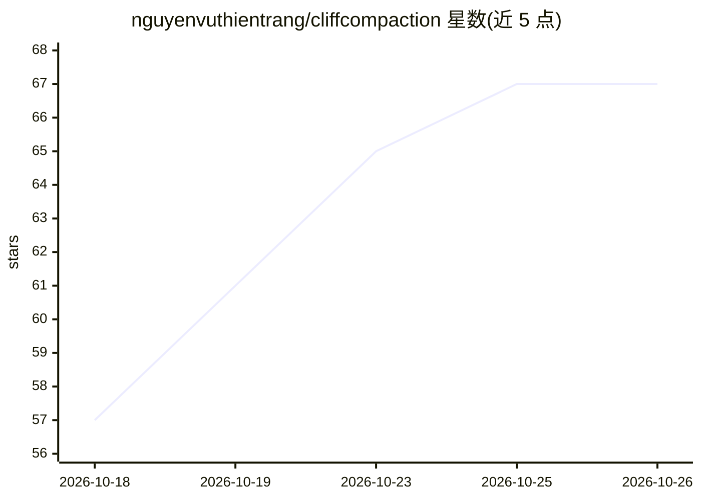

# nguyenvuthientrang/cliffcompaction

⭐ 67 · Python · MIT · 推送 2026-09-23 · [GitHub](https://github.com/nguyenvuthientrang/cliffcompaction) · 组织维护

**透明 API 代理：自动压缩长会话编码 agent 的上下文**

面向长时程编码 agent 的自动上下文压缩代理。将 agent 的 base URL 指向本代理，超出 token 阈值时按内容类别机械式重建历史（头部与近期轮次保留原文，中间替换为一条摘要消息），agent 本身无需改动。支持 Anthropic Messages 与 OpenAI Chat Completions/Responses 方言，提供多守护进程实例、shadow 观察模式与 fail-open 直通机制。以 pip/uv 安装的 Python 3.11+ CLI 工具，附 arXiv 论文引用。

## 筛选速览

| 维度 | 判定 | 备注 |
|---|---|---|
| AI 角色 | `ai-ecosystem` | LLM/agent 周边工具 |
| 许可风险 | `permissive` | MIT |
| 部署形态 | `library` | 以包/库形式分发 |
| 模型依赖 | — | README 未给出锁定关系 |
| 硬件要求 | — | 无带数字的原话,不猜 |
| 安装摩擦 | `low` | 无编译、无系统依赖或容器化 |
| 成熟度 | — | 结构信号不足 |

## 能力要点

- 按内容类别的机械式摘要：工具结果超 500 字符丢弃、助手文本默认全保留
- 前缀哈希链匹配，后续请求自动替换为压缩版本
- shadow 观察模式：仅记录将压缩的内容，不做修改
- fail-open 契约：任何解析/匹配失败均按原文直通

## 适用场景

- 让 Claude Code 等编码 agent 长会话保持在 token 预算内
- 在不改动 agent 的前提下接管其上下文压缩
- 先以 shadow 模式观察压缩行为再启用

## 场景标签

`Agent 记忆` · 领域:Agent 开发

## 证据(README 行号)

> L5: Autocompaction for coding agents, as a transparent API proxy. Point an agent's base URL at it and long sessions stay
> L103: 2. If the outgoing size exceeds the threshold, it rebuilds the history as `[head verbatim] + [one CliffCompaction 

## 星数曲线

2026-10-18 57 → 2026-10-26 67（+10）

---
*卡片 v1 · prompt 1.4 · 生成 2026-10-24 · 置信度 high · 依据 README sha `d8d5d6efa372` · [字段定义](../../DATASET.md)*
