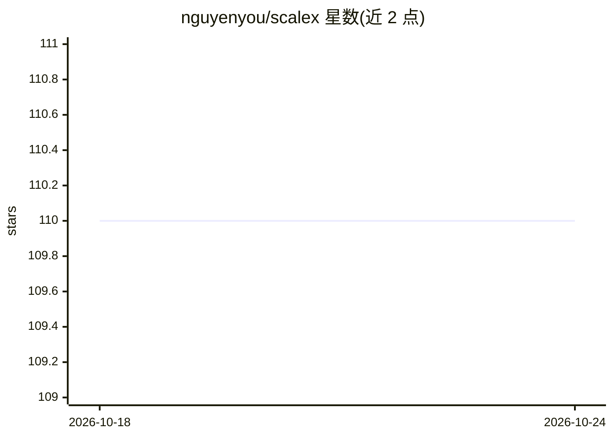

# nguyenyou/scalex

⭐ 110 · Scala · MIT · 推送 2026-09-18 · [GitHub](https://github.com/nguyenyou/scalex) · [官网](https://nguyenyou.github.io/scalex/) · 个人维护

**给编码 Agent 的 Scala 代码智能查询插件，免编译免构建服务器**

面向 Codex CLI 与 Claude Code 等编码 Agent 的 Scala/Java 代码智能工具：通过 Git 发现源文件，用 Scalameta 与 JavaParser 直接解析，将符号与搜索过滤器存入 .scalex/index.bin 缓存，支持定义查找、引用候选、类型解释、继承层次、diff、测试提及等查询，以 JSON 输出并支持批量查询。以原生二进制分发（macOS Apple Silicon/Intel、Linux x64），无需 JVM、无守护进程。边界：不做编译器级类型解析，引用结果为候选而非精确。

## 筛选速览

| 维度 | 判定 | 备注 |
|---|---|---|
| AI 角色 | `ai-ecosystem` | LLM/agent 周边工具 |
| 许可风险 | `permissive` | MIT |
| 部署形态 | `None` |  |
| 模型依赖 | locked-api |  |
| 硬件要求 | — | 无带数字的原话,不猜 |
| 安装摩擦 | `low` | 无编译、无系统依赖或容器化 |
| 成熟度 | — | 结构信号不足 |

## 能力要点

- 免编译、免构建服务器，直接解析 Git 追踪的 Scala 2/3 与 Java 源码
- 符号索引缓存在 .scalex/index.bin，增量复用未变更记录
- 提供 def/refs/explain/hierarchy/diff/tests 等约 30 个查询命令
- 原生二进制 + 自举脚本下载并校验 SHA-256，无 JVM 依赖

## 适用场景

- 让编码 Agent 在未配置构建的陌生 Scala 仓库中定位符号与阅读代码
- 一次性查询类型定义、成员、实现与文档作为上下文
- 查看相对 main 分支变更的声明与相关测试

## 场景标签

 · 领域:开发者工具/代码智能

## 证据(README 行号)

> L7: Scalex helps coding agents find definitions, explore types, and locate reference candidates in Git-tracked Scala 2, 
> L162: Scalex discovers tracked Scala and Java files through Git, parses them with Scalameta and JavaParser, and stores s

## 星数曲线

2026-10-18 110 → 2026-10-24 110（+0）

---
*卡片 v1 · prompt 1.4 · 生成 2026-10-23 · 置信度 high · 依据 README sha `b63109000235` · [字段定义](../../DATASET.md)*
