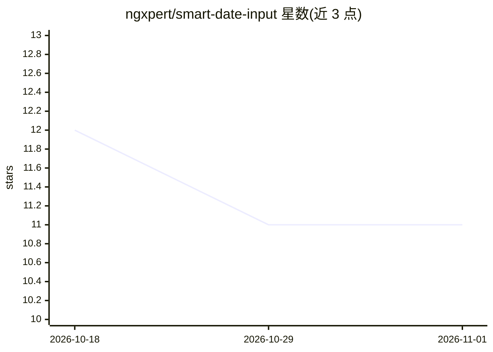

# ngxpert/smart-date-input

⭐ 11 · HTML · 推送 2025-12-16 · [GitHub](https://github.com/ngxpert/smart-date-input) · [官网](https://stackblitz.com/github/ngxpert/smart-date-input) · 组织维护

**用 Chrome 内置 Writer API 解析自然语言日期的 Angular 指令**

面向 Angular 开发者的输入框指令库：在原生 input 上添加 smartDateInput 指令后，通过浏览器 Chrome 的 Writer API 将自然语言日期文本解析为单个日期或日期范围，解析结果经事件回调返回。安装需先 ng build 构建库再 ng serve 运行应用。限制：仅在 Chrome 上可用，且需启用 Writer API（localhost 或 origin trial 两种方式）。

## 筛选速览

| 维度 | 判定 | 备注 |
|---|---|---|
| AI 角色 | `ai-ecosystem` | LLM/agent 周边工具 |
| 许可风险 | `none` | — |
| 部署形态 | `None` |  |
| 模型依赖 | — | README 未给出锁定关系 |
| 硬件要求 | — | 无带数字的原话,不猜 |
| 安装摩擦 | `low` | 无编译、无系统依赖或容器化 |
| 成熟度 | — | 结构信号不足 |

## 能力要点

- Angular 指令形式，单行 HTML 属性即可启用
- 支持单个日期与日期范围两种解析模式
- 基于 Chrome 内置 Writer API，无需外部服务

## 适用场景

- 在表单中让用户用自然语言填写日期
- 需要日期范围输入时以文本方式快捷输入

## 场景标签

 · 领域:Web 前端组件

## 证据(README 行号)

> L3: A smart date input directive that uses the Writer API to parse natural language dates.
> L7: Works only on Chrome. You need to enable the Writer API.

## 星数曲线

2026-10-18 12 → 2026-11-01 11（-1）

---
*卡片 v1 · prompt 1.4 · 生成 2026-11-01 · 置信度 high · 依据 README sha `32a172c01255` · [字段定义](../../DATASET.md)*
