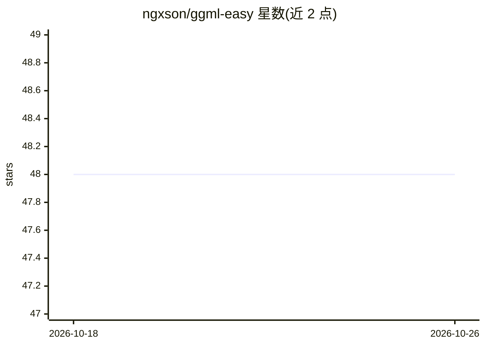

# ngxson/ggml-easy

⭐ 48 · C++ · MIT · 推送 2026-07-26 · [GitHub](https://github.com/ngxson/ggml-easy) · 个人维护

**简化 GGML 模型加载与执行的头文件库，支持 GPU 加速**

ggml-easy 是一个 header-only 的 C++ 库，封装 GGML（llama.cpp 所用的张量库），提供加载 GGUF 模型、创建计算图、CPU/GPU 执行的接口，减少样板代码。GPU 默认启用（通过 use_gpu 参数可关闭），部分算子在 GPU 不支持时回退到 CPU。支持直接加载 .safetensors 文件（F32/F16/BF16）而无需转换为 GGUF，多分片暂不支持。还提供输入输出节点单行定义与中间结果 debug_print 调试功能。

## 筛选速览

| 维度 | 判定 | 备注 |
|---|---|---|
| AI 角色 | `ai-ecosystem` | LLM/agent 周边工具 |
| 许可风险 | `permissive` | MIT |
| 部署形态 | `None` |  |
| 模型依赖 | — | README 未给出锁定关系 |
| 硬件要求 | — | 无带数字的原话,不猜 |
| 安装摩擦 | `medium` | 含编译或系统依赖之一 |
| 成熟度 | `idea` | |

## 能力要点

- 加载 GGUF 模型并以 CPU/GPU 执行计算图
- 默认启用 GPU，抽象掉 scheduler 与 buffer 设置
- 直接加载 .safetensors（F32/F16/BF16），无需转 GGUF
- 单行定义输入输出节点与中间结果打印调试

## 适用场景

- 在 C++ 项目中以较少代码加载并运行 GGUF 模型
- 直接加载 safetensors 权重做张量计算
- 调试计算图中间张量的数值

## 场景标签

`推理引擎` · 领域:训练与推理

## 证据(README 行号)

> L3: A simple C++ wrapper around GGML to make model loading and execution easier with GPU acceleration support.
> L7: `ggml-easy` is a lightweight header-only C++ library that simplifies working with GGML, the tensor library used in p

## 星数曲线

2026-10-18 48 → 2026-10-26 48（+0）

---
*卡片 v1 · prompt 1.4 · 生成 2026-10-25 · 置信度 high · 依据 README sha `be96c9660f91` · [字段定义](../../DATASET.md)*
