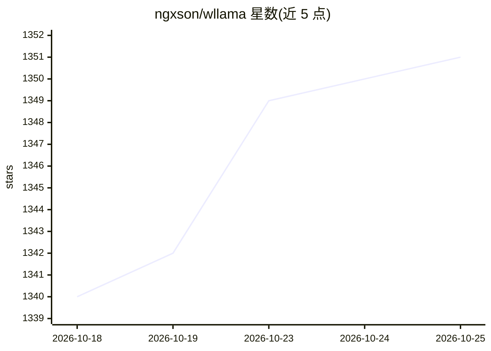

# ngxson/wllama

⭐ 1,351 · TypeScript · MIT · 推送 2026-10-20 · [GitHub](https://github.com/ngxson/wllama) · [官网](https://huggingface.co/spaces/ngxson/wllama) · 个人维护

**llama.cpp 的 WebAssembly 绑定，在浏览器内直接运行 LLM 推理**

面向 Web 开发者的 TypeScript/npm 库，将 llama.cpp 编译为 Wasm 在浏览器中执行推理，无需后端或 GPU；通过 WebAssembly SIMD 与 worker 运行，不阻塞 UI 渲染。V3 支持 WebGPU（可调 n_gpu_layers 控制层数下放）、多模态输入、工具调用与 OpenAI 兼容 API。支持 GGUF 模型分片并行加载，单文件上限 2GB；多线程需配置 COEP/COOP 头。npm 包预构建，自行编译需 Docker。

## 筛选速览

| 维度 | 判定 | 备注 |
|---|---|---|
| AI 角色 | `ai-ecosystem` | LLM/agent 周边工具 |
| 许可风险 | `permissive` | MIT |
| 部署形态 | `desktop` | 安装包/桌面程序 |
| 模型依赖 | local-ok | 支持本地模型 |
| 硬件要求 | — | 无带数字的原话,不猜 |
| 安装摩擦 | `low` | 无编译、无系统依赖或容器化 |
| 成熟度 | — | 结构信号不足 |

## 能力要点

- 浏览器内直接推理（Wasm SIMD），无需后端或 GPU
- WebGPU 支持与可调 GPU 层数下放
- 多模态（图像/音频）、工具调用与 OpenAI 兼容 API
- GGUF 模型分片并行下载加载（单文件限 2GB）

## 适用场景

- 在网页中直接加载 GGUF 模型做补全或嵌入
- 构建无需后端的浏览器端 LLM 应用
- 多模态视觉补全与工具调用的前端原型

## 场景标签

`推理引擎` · 领域:训练与推理

## 证据(README 行号)

> L1: # wllama - Wasm binding for llama.cpp
> L25: - Can run inference directly on browser (using WebAssembly SIMD), no backend or GPU is needed!

## 星数曲线

2026-10-18 1,340 → 2026-10-25 1,351（+11）

---
*卡片 v1 · prompt 1.4 · 生成 2026-10-21 · 置信度 mid · 依据 README sha `3926778538bb` · [字段定义](../../DATASET.md)*
