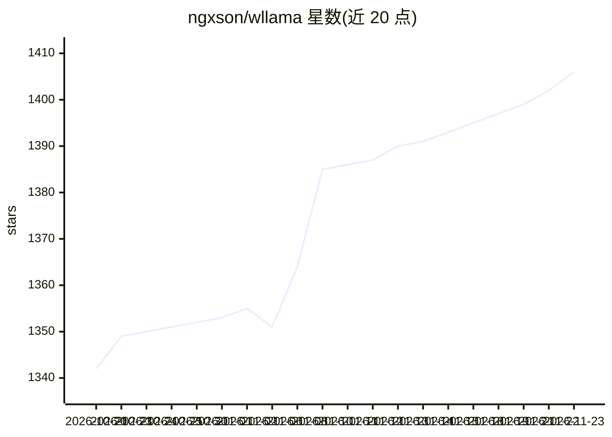

# ngxson/wllama

⭐ 1,406 · TypeScript · MIT · 推送 2026-11-22 · [GitHub](https://github.com/ngxson/wllama) · [官网](https://huggingface.co/spaces/ngxson/wllama) · 个人维护

**在浏览器内直接运行 llama.cpp 推理的 WebAssembly 绑定库**

将 llama.cpp 编译为 WebAssembly 供前端调用的 npm 库：开发者加载 GGUF 模型文件后，推理在浏览器内的 worker 中完成，无需后端服务器。支持 WebGPU 卸载（模型放不下 GPU 时 CPU+GPU 混合运行）、OpenAI 兼容 API、多模态输入、语音合成/转写/实时会话、tool calling、投机解码与 LoRA 适配器；模型缓存于 OPFS，支持大于 4GB 的单文件加载与跨 worker 分片。限制包括多线程需要特定 COOP/COEP 响应头，wasm 单实例内存上限 4GB。

## 筛选速览

| 维度 | 判定 | 备注 |
|---|---|---|
| AI 角色 | `ai-ecosystem` | LLM/agent 周边工具 |
| 许可风险 | `permissive` | MIT |
| 部署形态 | `desktop` | 安装包/桌面程序 |
| 模型依赖 | local-ok | 支持本地模型 |
| 硬件要求 | — | 无带数字的原话,不猜 |
| 安装摩擦 | `low` | 无编译、无系统依赖或容器化 |
| 成熟度 | — | 结构信号不足 |

## 能力要点

- 浏览器内推理（WebAssembly SIMD），无需后端或 GPU
- WebGPU 卸载，模型超出显存时 CPU+GPU 混合运行，可设 n_gpu_layers
- GGUF 文件按原样加载，超 4GB 自动跨 worker 分片，OPFS 缓存与断点续传
- 语音能力：TTS、转写、实时全双工音频会话（OpenAI realtime 风格事件）

## 适用场景

- 在前端网页中直接跑 GGUF 模型做补全、嵌入或视觉理解
- 网页端实现语音对话、实时转写或语音翻译
- 开发不依赖服务端、模型在用户浏览器本地运行的 LLM 应用

## 场景标签

`推理引擎` · 领域:训练与推理

## 证据(README 行号)

> L3: WebAssembly binding for llama.cpp
> L26: - Can run inference directly on browser (using WebAssembly SIMD), no backend or GPU is needed!
> L33: - Pre-built npm package @wllama/wllama

## 星数曲线

2026-10-20 1,342 → 2026-11-23 1,406（+64）

---
*卡片 v1 · prompt 1.4 · 生成 2026-11-23 · 置信度 high · 依据 README sha `f3549023aa16` · [字段定义](../../DATASET.md)*
