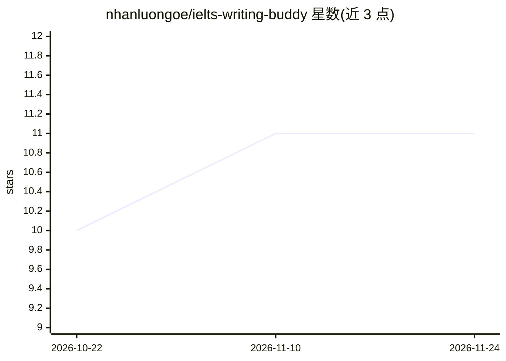

# nhanluongoe/ielts-writing-buddy

⭐ 11 · TypeScript · MIT · 推送 2026-08-12 · [GitHub](https://github.com/nhanluongoe/ielts-writing-buddy) · [官网](https://ielts-writing-assistant.vercel.app) · 个人维护

**面向雅思考生的 AI 写作练习应用：生成范文并批改估分**

基于 Next.js/React/TypeScript/Tailwind 的 IELTS 写作练习应用，覆盖 Task 1 与 Task 2。用户可生成 IELTS 风格范文、对自己的作文获取纠错与改写建议、估算 band 分数，并支持图表/地图/流程图等图像类 Task 1 题目。AI 响应流式输出；用户在浏览器设置中自行提供 Gemini 或 OpenAI API key，密钥仅存于浏览器 session/local storage，请求从浏览器直发提供商。

## 筛选速览

| 维度 | 判定 | 备注 |
|---|---|---|
| AI 角色 | `ai-native` | 本体是模型或模型工具 |
| 许可风险 | `permissive` | MIT |
| 部署形态 | `library` | 以包/库形式分发 |
| 模型依赖 | — | README 未给出锁定关系 |
| 硬件要求 | — | 无带数字的原话,不猜 |
| 安装摩擦 | `low` | 无编译、无系统依赖或容器化 |
| 成熟度 | — | 结构信号不足 |

## 能力要点

- 生成 Task 1/Task 2 的 IELTS 风格范文与改写建议
- 对提交作文估算 band 分数并给出针对性反馈
- 支持 Gemini 与 ChatGPT 双提供商切换（各自官方 SDK）
- 支持 Task 1 图像类题目与流式输出反馈

## 适用场景

- 备考雅思写作时生成参考范文
- 让 AI 批改自己的作文并按建议改写
- 估算自己 Task 1/Task 2 作文的 band 分数

## 场景标签

`AI 写作` · 领域:内容生成

## 证据(README 行号)

> L3: IELTS Writing Buddy is an AI-powered practice app for IELTS Writing Task 1 and Task 2. It helps learners draft sampl
> L5: The app is built with Next.js, React, TypeScript, and Tailwind CSS. It supports multiple AI providers, including Goo
> L24: - Switch between supported AI providers from the app settings.

## 星数曲线

2026-10-22 10 → 2026-11-24 11（+1）

---
*卡片 v1 · prompt 1.4 · 生成 2026-11-18 · 置信度 high · 依据 README sha `a373f594055d` · [字段定义](../../DATASET.md)*
