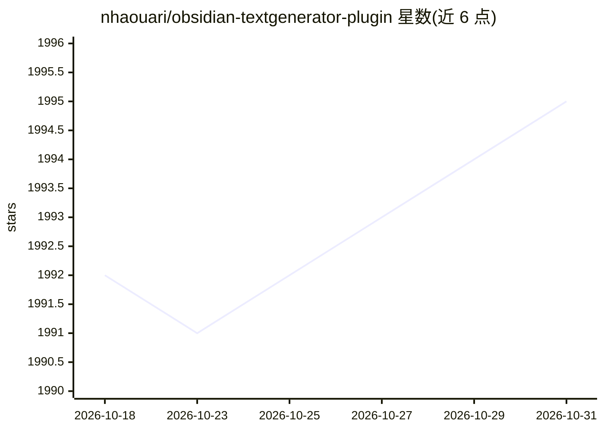

# nhaouari/obsidian-textgenerator-plugin

⭐ 1,995 · TypeScript · MIT · 推送 2026-08-06 · [GitHub](https://github.com/nhaouari/obsidian-textgenerator-plugin) · [官网](https://text-gen.com/) · 个人维护

**Obsidian 插件：在笔记库中调用 AI 生成与组织文本内容**

面向 Obsidian 个人知识管理用户的 AI 助手插件：基于笔记库上下文生成想法、标题、摘要、大纲与段落；提供模板引擎与社区共享模板，支持通过 Frontmatter 配置切换不同服务（Google Generative AI 含 Gemini-Pro、OpenAI、HuggingFace 等）。以 Obsidian 社区插件方式安装，或通过 git clone 源码并用 pnpm 安装依赖构建。

## 筛选速览

| 维度 | 判定 | 备注 |
|---|---|---|
| AI 角色 | `ai-native` | 本体是模型或模型工具 |
| 许可风险 | `permissive` | MIT |
| 部署形态 | `library` | 以包/库形式分发 |
| 模型依赖 | — | README 未给出锁定关系 |
| 硬件要求 | — | 无带数字的原话,不猜 |
| 安装摩擦 | `low` | 无编译、无系统依赖或容器化 |
| 成熟度 | — | 结构信号不足 |

## 能力要点

- 基于知识库上下文生成想法、标题、摘要、大纲与段落
- 模板引擎处理重复任务，支持社区共享模板
- Frontmatter 配置可切换不同 AI 服务（Gemini、OpenAI、HuggingFace 等）

## 适用场景

- 在笔记中让 AI 基于已有知识库内容续写或生成摘要
- 用模板自动化重复的文本生成任务
- 通过社区模板发现和复用他人用例

## 场景标签

`AI 写作` · 领域:内容生成

## 证据(README 行号)

> L11: **Text Generator** is an open-source AI Assistant Tool that brings the power of Generative Artificial Intelligence 
> L13: For example, use Text Generator to generate ideas, attractive titles, summaries, outlines, and whole paragraphs bas

## 星数曲线

2026-10-18 1,992 → 2026-10-31 1,995（+3）

---
*卡片 v1 · prompt 1.4 · 生成 2026-10-21 · 置信度 mid · 依据 README sha `3bf176633a12` · [字段定义](../../DATASET.md)*
