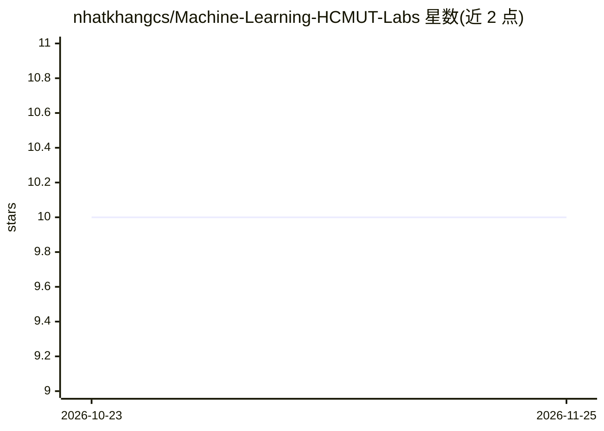

# nhatkhangcs/Machine-Learning-HCMUT-Labs

⭐ 10 · Jupyter Notebook · 推送 2026-06-27 · [GitHub](https://github.com/nhatkhangcs/Machine-Learning-HCMUT-Labs) · 个人维护

**给机器学习课学生的实验代码与教程仓库**

胡志明市理工大学（HCMUT）机器学习课程的实验（labs）集合，按 Nguyen Duc Dung 博士课件顺序组织，帮助学生理解课程概念；README 仅含课程来源与定位说明，属于教学实验内容仓库，需按课程实验要求运行。

## 筛选速览

| 维度 | 判定 | 备注 |
|---|---|---|
| AI 角色 | `ai-knowledge` | 知识聚合/清单类 |
| 许可风险 | `none` | — |
| 部署形态 | `None` |  |
| 模型依赖 | — | README 未给出锁定关系 |
| 硬件要求 | — | 无带数字的原话,不猜 |
| 安装摩擦 | `low` | 无编译、无系统依赖或容器化 |
| 成熟度 | — | 结构信号不足 |

## 能力要点

- HCMUT 机器学习课程实验集合
- 按 Dr. Nguyen Duc Dung 课件顺序组织概念讲解

## 适用场景

- 跟随课程进度完成机器学习实验
- 复习课件中对应的机器学习概念

## 场景标签

`教程课程` · 领域:学习与行业

## 证据(README 行号)

> L1: # Machine-Learning-Labs
> L3: This repository contains the labs for the Machine Learning course at Ho Chi Minh City University of Technology - Vie

## 星数曲线

2026-10-23 10 → 2026-11-25 10（+0）

---
*卡片 v1 · prompt 1.4 · 生成 2026-11-19 · 置信度 high · 依据 README sha `88d3b5df8e86` · [字段定义](../../DATASET.md)*
