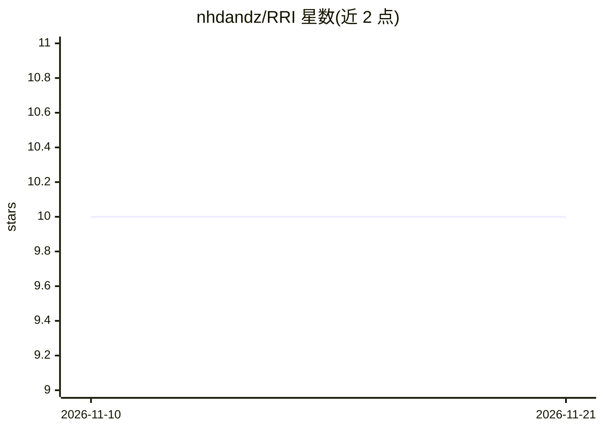

# nhdandz/RRI

⭐ 10 · Python · MIT · 推送 2026-05-08 · [GitHub](https://github.com/nhdandz/RRI) · 个人维护

**面向科研人员的自托管论文/仓库聚合与 RAG 问答平台**

全栈自托管平台，面向研究者、工程师与团队：从 ArXiv、Semantic Scholar、GitHub、HuggingFace 等 11+ 来源持续采集论文、仓库与社区讨论，经 NLP 流水线处理后索引入 Qdrant 向量数据库，提供语义检索、RAG 文档对话、趋势分析与 Tech Radar，并带每周报告、书签库与 OSINT CLI。部署通过 Docker Compose 启动 8 个容器；RAG 双 LLM 路径为本地 Ollama（Llama 3）与可选 OpenAI GPT-4o（需 API key）。采用 MIT 许可，未见双许可声明。

## 筛选速览

| 维度 | 判定 | 备注 |
|---|---|---|
| AI 角色 | `ai-native` | 本体是模型或模型工具 |
| 许可风险 | `permissive` | MIT |
| 部署形态 | `self-host` | docker 或自建部署 |
| 模型依赖 | local-ok | 支持本地模型 |
| 硬件要求 | — | 无带数字的原话,不猜 |
| 安装摩擦 | `low` | 无编译、无系统依赖或容器化 |
| 成熟度 | — | 结构信号不足 |

## 能力要点

- 11+ 来源自动采集：ArXiv、Semantic Scholar、OpenReview、Hacker News 等
- RAG 文档对话：上传 PDF/DOCX/PPTX 或经 gitingest 摄入 GitHub 仓库
- Qdrant + BGE 嵌入的语义搜索，覆盖论文与仓库
- 内置 OSINT CLI：collect/search/analyze/export/chat 子命令

## 适用场景

- 跟踪本领域新论文并获取 AI 摘要
- 把 PDF 论文拖进来直接提问讨论
- 监控热门 GitHub 仓库与 HuggingFace 模型趋势
- 团队搭建带书签与周报的集中知识库

## 场景标签

`RAG` `语义搜索` `向量数据库` `科研工具` · 领域:知识与检索

## 证据(README 行号)

> L24: **RRI (Research & Repository Intelligence)** is a full-stack, self-hosted platform designed for researchers, engine
> L26: RRI continuously collects data from **11+ sources**, processes it with NLP pipelines, indexes everything into a **v
> L80: - **Retrieval-Augmented Generation** pipeline with context-aware answers

## 星数曲线

2026-11-10 10 → 2026-11-21 10（+0）

---
*卡片 v1 · prompt 1.4 · 生成 2026-11-19 · 置信度 high · 依据 README sha `29387bea4d7f` · [字段定义](../../DATASET.md)*
