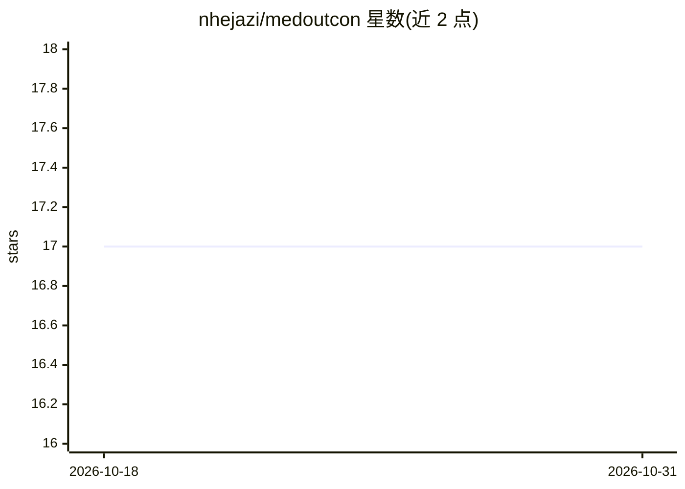

# nhejazi/medoutcon

⭐ 17 · R · NOASSERTION · 推送 2026-10-20 · [GitHub](https://github.com/nhejazi/medoutcon) · [官网](https://codex.nimahejazi.org/medoutcon) · 个人维护

**R 因果中介分析包：高效估计自然/干预(不)直接效应**

R 语言统计包，估计处理变量 A 对结局 Y 的路径特异性直接与间接效应；存在受处理影响的中介-结局混杂 Z 时对应 Díaz 等 (2020) 的干预效应，无混杂时简化为自然效应。提供带交叉拟合的单步偏差校正估计器与交叉验证 TMLE 两种估计器，并通过集成 sl3 包在 nuisance 参数估计中使用统计机器学习（数据自适应回归，附 vignette 说明）。面向因果推断方向的科研用户，从 GitHub 安装，含示例代码与 BibTeX 引用条目。

## 筛选速览

| 维度 | 判定 | 备注 |
|---|---|---|
| AI 角色 | `ai-enhanced` | 去掉 AI 部分产品仍成立 |
| 许可风险 | `permissive` | NOASSERTION |
| 部署形态 | `None` |  |
| 模型依赖 | — | README 未给出锁定关系 |
| 硬件要求 | — | 无带数字的原话,不猜 |
| 安装摩擦 | `low` | 无编译、无系统依赖或容器化 |
| 成熟度 | — | 结构信号不足 |

## 能力要点

- 同时提供单步偏差校正估计器（交叉拟合）与 CV-TMLE 估计器
- 支持干预效应与自然效应两类定义，覆盖中间混杂情形
- 集成 sl3 包以机器学习估计 nuisance 参数
- 附示例代码、vignette 与 JOSS 论文引用条目

## 适用场景

- 观察数据中分解处理对结局的直接与间接效应
- 存在中介-结局混杂（自身受处理影响）时的中介分析
- 用机器学习方法做 nuisance 参数的数据自适应回归估计

## 场景标签

 · 领域:统计/因果推断

## 证据(README 行号)

> L23: The `medoutcon` R package provides facilities for efficient estimation
> L43: available. `medoutcon` integrates with the [`sl3` R
> L70: For details on how to use data adaptive regression (machine learning)

## 星数曲线

2026-10-18 17 → 2026-10-31 17（+0）

---
*卡片 v1 · prompt 1.4 · 生成 2026-10-29 · 置信度 mid · 依据 README sha `b6ab7e78956b` · [字段定义](../../DATASET.md)*
