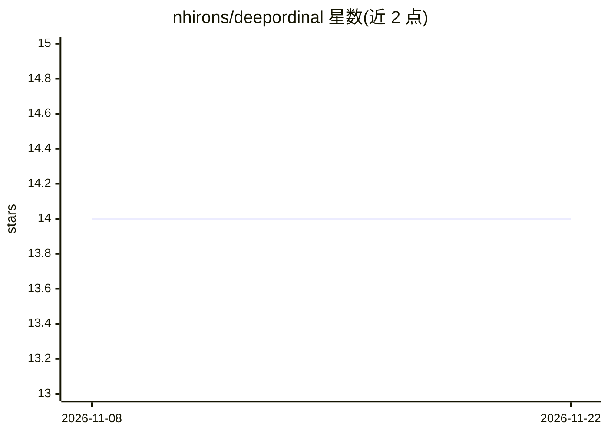

# nhirons/deepordinal

⭐ 14 · Python · MIT · 推送 2026-11-05 · [GitHub](https://github.com/nhirons/deepordinal) · 个人维护

**三后端统一的序数回归输出层与损失函数库**

为 PyTorch、TensorFlow/Keras 与 JAX/Flax NNX 提供统一的序数回归组件：OrdinalOutput 层将特征投影为单一 logit 并与 K-1 个有序阈值比较，生成 K 个有序类别概率，阈值通过构造保证有序且不产生负概率；同时实现 Rennie & Srebro (2005) 的 ordinal_loss（all/immediate 两种构造、logistic/hinge 等四种 penalty）、cumulative_link_loss 与 ordistic_loss。三后端共享同一 API，log 概率用 softplus 与 log1mexp 计算避免浮点下溢。以 pip 包分发，需 Python 3.10+（JAX 后端需 3.11+）。

## 筛选速览

| 维度 | 判定 | 备注 |
|---|---|---|
| AI 角色 | `ai-native` | 本体是模型或模型工具 |
| 许可风险 | `permissive` | MIT |
| 部署形态 | `library` | 以包/库形式分发 |
| 模型依赖 | — | README 未给出锁定关系 |
| 硬件要求 | — | 无带数字的原话,不猜 |
| 安装摩擦 | `low` | 无编译、无系统依赖或容器化 |
| 成熟度 | — | 结构信号不足 |

## 能力要点

- OrdinalOutput 层生成 K 个有序类别概率，阈值构造上有序
- 实现 Rennie & Srebro (2005) 的三种损失函数及多种 penalty
- PyTorch/TF-Keras/JAX-Flax 三后端共享同一 API
- log 概率采用 softplus/log1mexp 数值稳定计算

## 适用场景

- 我在 PyTorch/Keras/Flax 模型中做有序标签的回归或分类
- 我需要校准的序数概率做期望代价决策
- 我想对比论文中的 all-threshold 与 immediate-threshold 损失

## 场景标签

 · 领域:机器学习库

## 证据(README 行号)

> L7: Ordinal regression for PyTorch, TensorFlow/Keras, and JAX/Flax: an `OrdinalOutput` layer that turns features into K 
> L50: `OrdinalOutput` projects its input to one logit `z` and compares it with K-1 ordered thresholds `t`:

## 星数曲线

2026-11-08 14 → 2026-11-22 14（+0）

---
*卡片 v1 · prompt 1.4 · 生成 2026-11-18 · 置信度 high · 依据 README sha `145853e85d38` · [字段定义](../../DATASET.md)*
