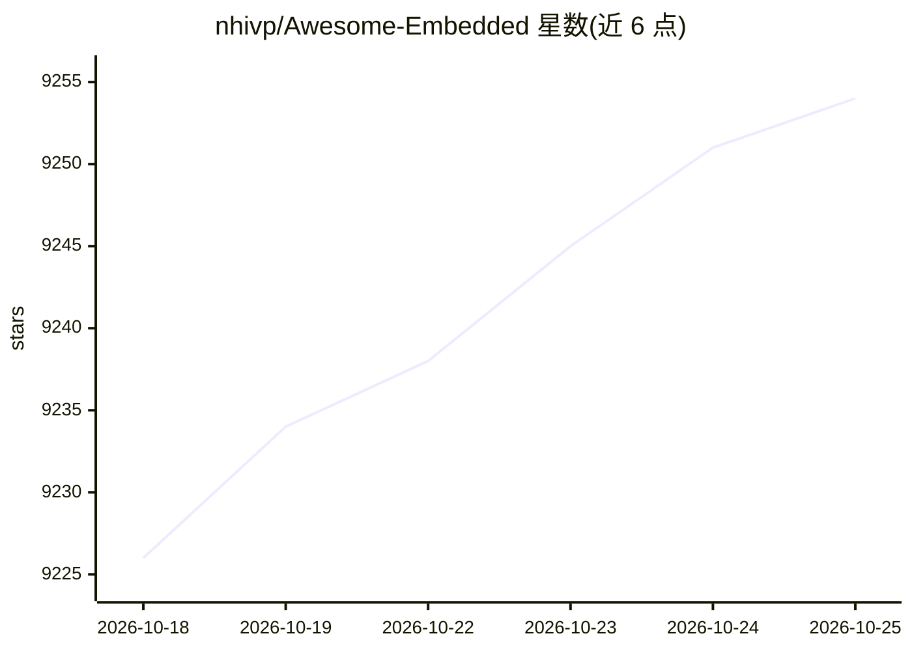

# nhivp/Awesome-Embedded

⭐ 9,266 · Unlicense · 推送 2026-10-10 · [GitHub](https://github.com/nhivp/Awesome-Embedded) · [官网](https://nhivp.github.io/Awesome-Embedded/) · 个人维护

**嵌入式编程资源策展清单：链接教程、RTOS、裸机开发资料**

由个人维护的 awesome 类资源清单，收录嵌入式开发学习与参考资源，按面试、嵌入式技能、MCU 编程（MSP430/TM4C123/STM32/STM8/ESP8266）、Raspberry Pi、BeagleBone、Linux 内核与驱动、汇编、RTOS 等类别组织。条目涵盖裸机编程教程、bootloader 项目、FreeRTOS 等实时操作系统移植、开发模板与课程。清单为链接目录形式，不含可安装的本体代码，读者按需跳转外部仓库。

## 筛选速览

| 维度 | 判定 | 备注 |
|---|---|---|
| AI 角色 | `ai-knowledge` | 知识聚合/清单类 |
| 许可风险 | `permissive` | Unlicense |
| 部署形态 | `None` |  |
| 模型依赖 | — | README 未给出锁定关系 |
| 硬件要求 | — | 无带数字的原话,不猜 |
| 安装摩擦 | `medium` | 含编译或系统依赖之一 |
| 成熟度 | — | 结构信号不足 |

## 能力要点

- 按 MCU 平台（STM32/TM4C123/MSP430/STM8/ESP8266）分类整理开发资源
- 覆盖裸机编程、bootloader、RTOS 移植与 Linux 驱动开发主题
- 收录 FreeRTOS、RT-Thread、AliOS-Things 等多种实时操作系统条目

## 适用场景

- 入门嵌入式开发时按平台查找教程与模板项目
- 为 STM32、Raspberry Pi 等板卡寻找裸机与 RTOS 参考实现
- 准备嵌入式岗位面试时查阅问题与技能资料

## 场景标签

`精选清单` · 领域:学习与行业

## 证据(README 行号)

> L3: A curated list of awesome embedded resource.
> L5: Table of content

## 星数曲线

2026-10-18 9,226 → 2026-10-25 9,254（+28）

---
*卡片 v1 · prompt 1.4 · 生成 2026-10-20 · 置信度 high · 依据 README sha `d0203c647c64` · [字段定义](../../DATASET.md)*
