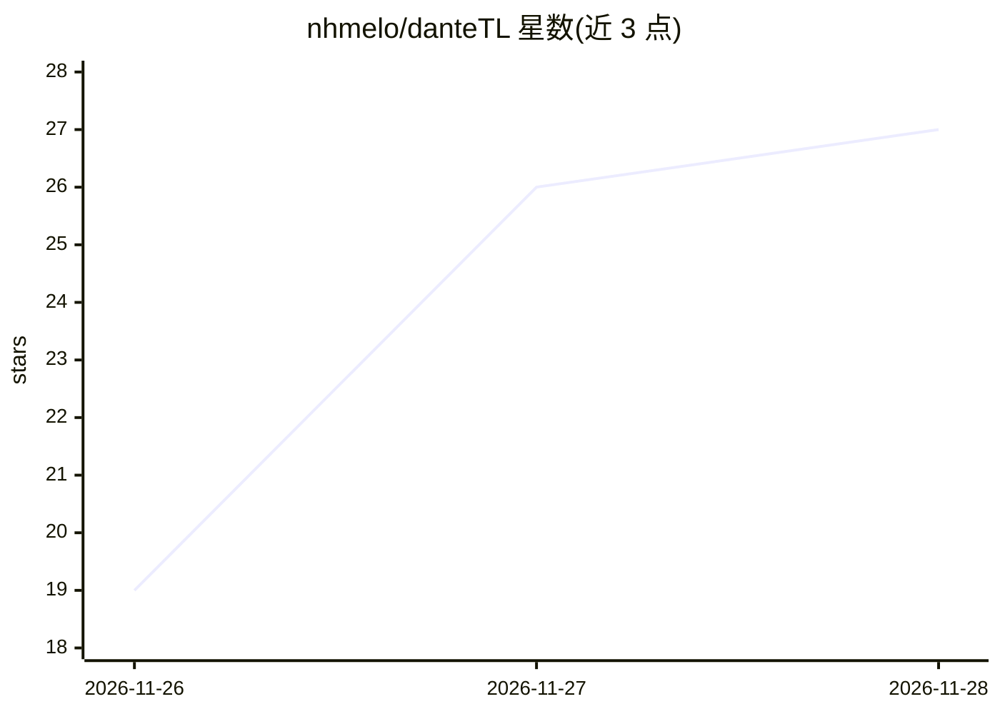

# nhmelo/danteTL

⭐ 27 · Python · Apache-2.0 · 推送 2026-11-27 · [GitHub](https://github.com/nhmelo/danteTL) · 个人维护

**Windows 实时游戏屏幕翻译工具：OCR 叠加层读取游戏文字并翻译**

在 Windows 上以可点击穿透的悬浮叠加层实时翻译游戏屏幕文字，OCR 识别日文与 34 种拉丁字母语言，输出 19 种语言。翻译模型可组合：本地模型（Gemma、PLaMo、Qwen 系列，含下载体积与加速选项预览）、Ollama 服务器连接、云模型（ChatGPT 账号登录或 OpenAI/Gemini/DeepSeek/Claude API key）。NVIDIA CUDA 可加速识别与翻译，Vulkan 加速本地翻译器。以便携 ZIP 发行，含更新检查、快捷键控制与源码运行说明。

## 筛选速览

| 维度 | 判定 | 备注 |
|---|---|---|
| AI 角色 | `ai-native` | 本体是模型或模型工具 |
| 许可风险 | `permissive` | Apache-2.0 |
| 部署形态 | `desktop` | 安装包/桌面程序 |
| 模型依赖 | local-ok | 支持本地模型 |
| 硬件要求 | — | 无带数字的原话,不猜 |
| 安装摩擦 | `medium` | 含编译或系统依赖之一 |
| 成熟度 | — | 结构信号不足 |

## 能力要点

- 点击穿透叠加层实时翻译游戏画面文字，OCR 内置于 ZIP 无需 Python
- 本地模型、Ollama 服务器、云 API 三类翻译来源可组合
- NVIDIA CUDA 加速识别与翻译，Vulkan 加速本地翻译器
- 快捷键控制叠加层显隐与截取，含诊断与更新恢复机制

## 适用场景

- 边玩日文游戏边看英文/中文翻译叠加
- 无网络时用本地模型离线翻译游戏文本
- 用 Ollama 自建服务器上的模型翻译游戏对话

## 场景标签

`OCR` · 领域:感知与多模态

## 证据(README 行号)

> L3: DanteTL translates on-screen game text in a click-through Windows overlay. It reads Japanese
> L15:  - **Local models** starts with the recommended translator selected. Choose **None** to skip the local translator. 
> L61: Manage translators in **Settings → Models**. For GPU acceleration, open **Settings →

## 星数曲线

2026-11-26 19 → 2026-11-28 27（+8）

---
*卡片 v1 · prompt 1.4 · 生成 2026-11-26 · 置信度 high · 依据 README sha `b270c94ff9f2` · [字段定义](../../DATASET.md)*
