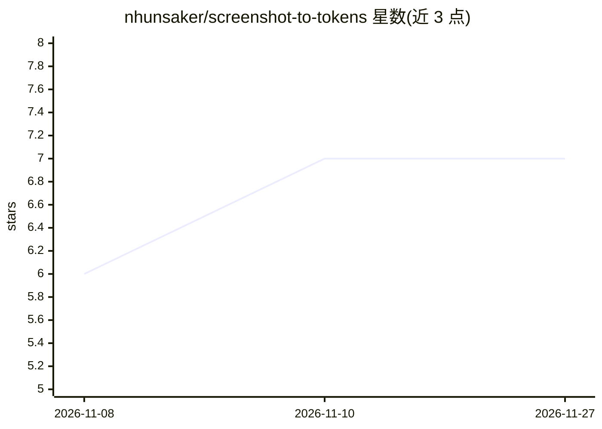

# nhunsaker/screenshot-to-tokens

⭐ 7 · JavaScript · Apache-2.0 · 推送 2026-11-13 · [GitHub](https://github.com/nhunsaker/screenshot-to-tokens) · 个人维护

**给前端开发者：从截图自动提取设计令牌并重写为 CSS 变量**

面向无设计令牌的线上 Web 应用的开发工具：Playwright 截取页面，SAM 3.1 从像素分割界面，聚类近重复值后由 Muse Spark 命名 primitive→semantic→component 三级令牌（每个令牌附理由），经人工 accept/rename/merge 审核后把硬编码字面量重写为 var(--token, original)，并以像素级比对、文本对比度（WCAG AA）、键盘焦点、暗色模式等检查验证重写未改变页面。各模型步骤均提供离线替身，无 API key 也可运行。注意：rewrite 阶段不支持 SCSS 的 .vue 文件。

## 筛选速览

| 维度 | 判定 | 备注 |
|---|---|---|
| AI 角色 | `ai-native` | 本体是模型或模型工具 |
| 许可风险 | `permissive` | Apache-2.0 |
| 部署形态 | `library` | 以包/库形式分发 |
| 模型依赖 | local-ok | 支持本地模型 |
| 硬件要求 | — | 无带数字的原话,不猜 |
| 安装摩擦 | `low` | 无编译、无系统依赖或容器化 |
| 成熟度 | — | 结构信号不足 |

## 能力要点

- 截图→分割→聚类→命名→重写→验证的完整流水线，模型步骤带离线替身
- 四种验证检查：0 px 像素比对、渲染像素级对比度、键盘焦点、暗色模式
- open weights 路径：SAM 3.1 跑 Modal GPU，Muse Spark Open 跑 Baseten/Fireworks
- point-and-say：点击控件后语音/文字下发修改，含对比度回归拦截

## 适用场景

- 为没有设计令牌的存量 Web 应用批量提取 token 并迁移到 CSS 变量
- 在开 PR 前验证重写未改变页面外观与可读性
- 用自然语言指令调整对比度、焦点环等可访问性相关 token

## 场景标签

`代码生成` · 领域:编码与开发

## 证据(README 行号)

> L4: Point it at a live web app that has no design tokens. It captures the page, **SAM 3.1** segments the interface from
> L97: capture → segment → join → cluster → name → validate → emit → rewrite → verify → report
> L138: Capture, join, cluster, emit, rewrite, and verify are deterministic code. Segment and name are the

## 星数曲线

2026-11-08 6 → 2026-11-27 7（+1）

---
*卡片 v1 · prompt 1.4 · 生成 2026-11-20 · 置信度 high · 依据 README sha `87393462d5fa` · [字段定义](../../DATASET.md)*
