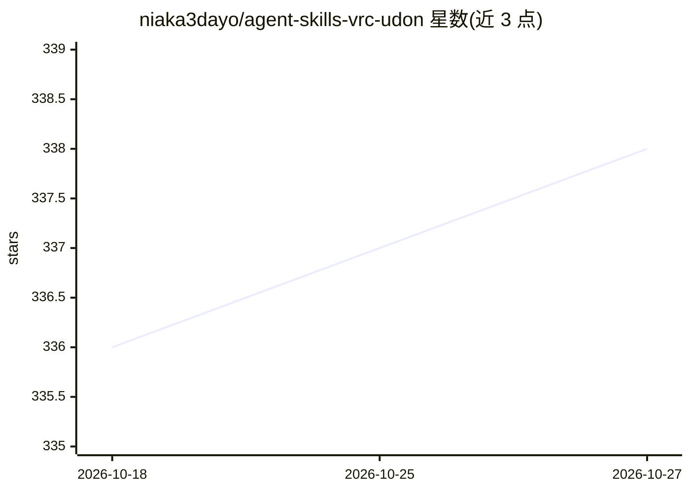

# niaka3dayo/agent-skills-vrc-udon

⭐ 338 · Shell · MIT · 推送 2026-09-14 · [GitHub](https://github.com/niaka3dayo/agent-skills-vrc-udon) · 个人维护 · 中文 README

**教 AI 编程代理正确生成 UdonSharp 代码的技能与规则知识库**

面向 VRChat 世界开发者的知识库项目：以 SKILL.md 技能、约束规则文件和校验钩子三种形式，向 AI 编程代理提供 UdonSharp（C#→Udon Assembly）的编译约束、网络同步模式、SDK 版本特性映射与 17 个代码模板。PostToolUse 钩子在编辑 .cs 文件后自动检测被阻塞的 C# 特性（async/await、List<T>、LINQ 等）并按 ERROR/WARNING 分级告警。自 v1.0.0 起以 npm 包分发，支持 skills CLI、Claude Code 插件与 git clone 三种安装方式；不提供可执行代码，仅验证至 VRChat SDK 3.10.5，不接受 PR，由维护者独立更新。

## 筛选速览

| 维度 | 判定 | 备注 |
|---|---|---|
| AI 角色 | `ai-knowledge` | 知识聚合/清单类 |
| 许可风险 | `permissive` | MIT |
| 部署形态 | `library` | 以包/库形式分发 |
| 模型依赖 | — | README 未给出锁定关系 |
| 硬件要求 | — | 无带数字的原话,不猜 |
| 安装摩擦 | `low` | 无编译、无系统依赖或容器化 |
| 成熟度 | — | 结构信号不足 |

## 能力要点

- UdonSharp 编译约束知识：被阻塞 C# 特性及其替代方案（List<T>→DataList 等）
- 同步决策树与数据预算目标（每 behaviour <50 字节）
- Bash/PowerShell 校验钩子自动检测违规代码并分级报错
- 17 个代码模板覆盖交互、同步、持久化与编辑器工具

## 适用场景

- 让 Claude Code 等 AI 代理在 VRChat 项目中生成可编译的 UdonSharp 代码
- 编辑 .cs 文件后自动校验 Udon 不支持的 C# 特性与网络同步问题
- 查询不同 VRChat SDK 版本的功能引入记录以做迁移参考

## 场景标签

`代码生成` · 领域:编码与开发

## 证据(README 行号)

> L14:  Skills, rules, and validation hooks that teach AI coding agents to generate correct UdonSharp code
> L29: This repository provides AI coding agents with the knowledge to generate correct UdonSharp code from the start.
> L230: > This repository is a **personal knowledge base** for AI coding agents to generate correct UdonSharp code. It doe

## 星数曲线

2026-10-18 336 → 2026-10-27 338（+2）

---
*卡片 v1 · prompt 1.4 · 生成 2026-10-21 · 置信度 high · 依据 README sha `0b6d14366f92` · [字段定义](../../DATASET.md)*
