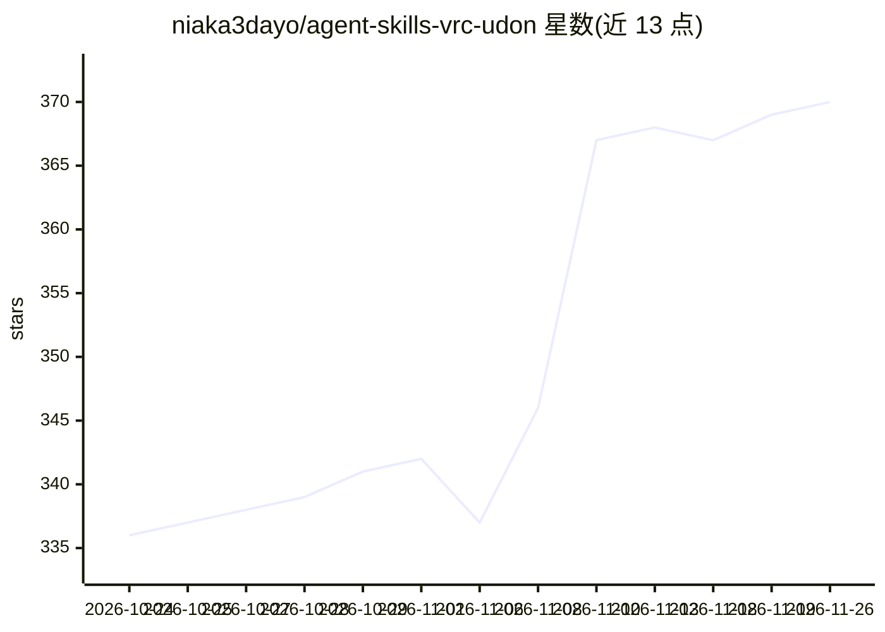

# niaka3dayo/agent-skills-vrc-udon

⭐ 370 · Shell · MIT · 推送 2026-11-11 · [GitHub](https://github.com/niaka3dayo/agent-skills-vrc-udon) · 个人维护

**教 AI 编码代理生成正确 UdonSharp 代码的技能知识库**

面向 AI 编码代理的 VRChat UdonSharp 知识库，包含技能文件（SKILL.md）、约束规则与验证钩子三类内容：技能覆盖编译限制、网络同步、事件、SDK 版本特性与 17 个代码模板；规则文件在代码生成前约束代理行为；PostToolUse 钩子检查代理写入的每个 .cs 文件并将发现反馈给代理，且从不阻止编辑。仅支持最新稳定 SDK 3.10.6，旧版条目标为历史参考。不分发 VRChat SDK 或 UdonSharp，不含可执行代码。

## 筛选速览

| 维度 | 判定 | 备注 |
|---|---|---|
| AI 角色 | `ai-knowledge` | 知识聚合/清单类 |
| 许可风险 | `permissive` | MIT |
| 部署形态 | `library` | 以包/库形式分发 |
| 模型依赖 | — | README 未给出锁定关系 |
| 硬件要求 | — | 无带数字的原话,不猜 |
| 安装摩擦 | `low` | 无编译、无系统依赖或容器化 |
| 成熟度 | — | 结构信号不足 |

## 能力要点

- 技能+规则+验证钩子三层结构，钩子检查代理写入的每个 .cs 文件
- 覆盖 Udon 运行时禁用的 C# 特性及其替代方案（List<T>→DataList 等）
- 包含同步决策树、数据预算目标与反模式库
- 同时支持 Bash 与 PowerShell 验证器，兼容 Codex 的 apply_patch 输入

## 适用场景

- 在 VRChat Unity 项目中让 Claude Code/Codex/Gemini CLI 生成符合 Udon 约束的代码
- 为世界开发查找 SDK 3.10.6 特性参考与同步模式模板
- 用验证钩子自动检测 AI 生成代码中的运行时禁用特性与同步膨胀

## 场景标签

`代码生成` · 领域:编码与开发

## 证据(README 行号)

> L14:  Skills, rules, and validation hooks that teach AI coding agents to generate correct UdonSharp code
> L29: This repository provides AI coding agents with the knowledge to generate correct UdonSharp code from the start.
> L248: > This repository is a **personal knowledge base** for AI coding agents to generate correct UdonSharp code. It doe

## 星数曲线

2026-10-24 336 → 2026-11-26 370（+34）

---
*卡片 v1 · prompt 1.4 · 生成 2026-11-25 · 置信度 high · 依据 README sha `891f0c122266` · [字段定义](../../DATASET.md)*
