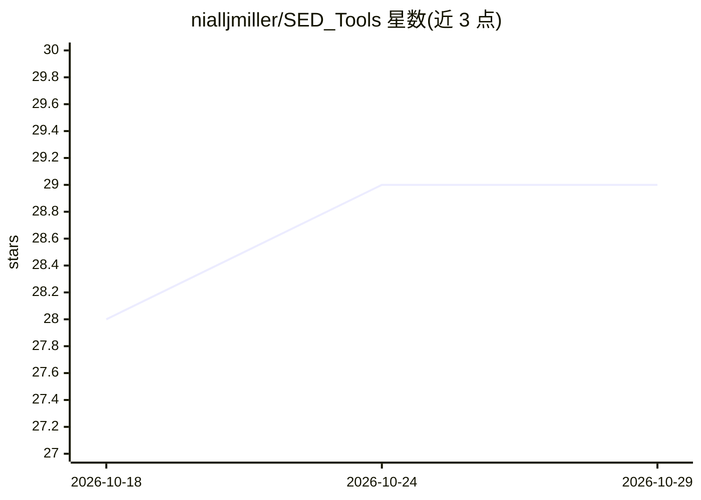

# nialljmiller/SED_Tools

⭐ 29 · Jupyter Notebook · MIT · 推送 2026-10-28 · [GitHub](https://github.com/nialljmiller/SED_Tools) · 个人维护

**天文学工具包：获取/标准化恒星光谱网格并合成测光数据**

面向恒星演化与测光建模研究者的 Python 包：从 SVO、MSG、MAST(BOSZ)、NJM 镜像下载模型光谱与滤光片透过率曲线，统一单位（波长 Å、流量 erg/cm²/s/Å），追踪光路各组件（大气/光学/滤光片/探测器 QE）与探测器响应类型（photon/energy），生成兼容 MESA colors 模块与 SED_Model 的二进制流量立方、HDF5 与查找表，支持多网格合并。ML 为可选功能：神经网络补全/生成 SED（需 PyTorch）。提供 CLI 与 Python API。

## 筛选速览

| 维度 | 判定 | 备注 |
|---|---|---|
| AI 角色 | `ai-enhanced` | 去掉 AI 部分产品仍成立 |
| 许可风险 | `permissive` | MIT |
| 部署形态 | `library` | 以包/库形式分发 |
| 模型依赖 | — | README 未给出锁定关系 |
| 硬件要求 | — | 无带数字的原话,不猜 |
| 安装摩擦 | `low` | 无编译、无系统依赖或容器化 |
| 成熟度 | — | 结构信号不足 |

## 能力要点

- 多源（SVO/MSG/MAST/NJM）光谱网格与滤光片曲线下载
- 单位标准化输出，生成 MESA colors 与 SED_Model 兼容格式
- 光路组件（大气/光学/QE）分解组合与探测器响应权重追踪
- 神经网络补全与按恒星参数生成 SED（需 PyTorch）

## 适用场景

- 为 MESA 模拟准备 colors 模块所需的滤光片与流量数据
- 下载并合并多个恒星光谱网格构建统一网格
- 用神经网络补全不完整 SED 或从 Teff/logg/[M/H] 生成 SED

## 场景标签

`科研工具` · 领域:学习与行业

## 证据(README 行号)

> L17: SED_Tools is a Python package for working with stellar spectral energy distributions (SEDs). It provides unified ac
> L28: - **ML completion** — Extend incomplete SEDs to broader wavelength ranges using neural networks
> L75: - numpy, pandas, h5py, astropy, matplotlib

## 星数曲线

2026-10-18 28 → 2026-10-29 29（+1）

---
*卡片 v1 · prompt 1.4 · 生成 2026-10-26 · 置信度 high · 依据 README sha `69b975540f6b` · [字段定义](../../DATASET.md)*
