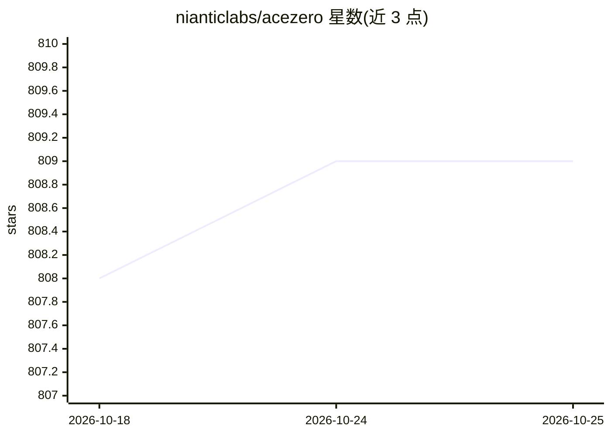

# nianticlabs/acezero

⭐ 809 · Python · NOASSERTION · 推送 2025-11-10 · [GitHub](https://github.com/nianticlabs/acezero) · [官网](https://nianticlabs.github.io/acezero/) · 组织维护

**学习式运动恢复结构：从图像集合估计相机位姿与场景重建**

ECCV 2024 Oral 论文的官方代码。基于 ACE 场景坐标回归模型（MLP）增量学习多视角一致的隐式场景表示，结合 DSAC* 的 C++ RANSAC 实现做相机配准，输出图像位姿文件（四元数+平移+焦距+置信度）与可选点云。支持焦距估计/精化、位姿精化、部分重建热启动、RGB-D 重建；限制：所有图像共享单一焦距、假设主点居中且像素方形无偏斜。首次运行需下载 ZoeDepth 深度估计模型。提供 conda 环境与 Docker 方式，需编译 C++ 绑定。

## 筛选速览

| 维度 | 判定 | 备注 |
|---|---|---|
| AI 角色 | `ai-native` | 本体是模型或模型工具 |
| 许可风险 | `none` | NOASSERTION |
| 部署形态 | `self-host` | docker 或自建部署 |
| 模型依赖 | — | README 未给出锁定关系 |
| 硬件要求 | — | 无带数字的原话,不猜 |
| 安装摩擦 | `low` | 无编译、无系统依赖或容器化 |
| 成熟度 | — | 结构信号不足 |

## 能力要点

- ACE 场景坐标回归 MLP + DSAC* RANSAC 的增量配准循环
- 输出位姿文件与可观点云（pc_final.ply）
- 支持无内参/已知焦距/位姿精化/部分重建热启动/RGB-D 重建
- 重建过程可视化视频导出（ffmpeg）

## 适用场景

- 从无序照片或视频帧集合估计相机位姿做 3D 重建
- 为 Nerfstudio（Nerfacto/Splatfacto）提供位姿输入
- 精化 COLMAP/KinectFusion 等已有位姿估计

## 场景标签

 · 领域:计算机视觉/3D 重建

## 证据(README 行号)

> L42: ACE0 represents a scene using an ACE scene coordinate regression model.
> L43: In order to register cameras to the scene, it relies on the RANSAC implementation of the DSAC* paper (Brachmann and

## 星数曲线

2026-10-18 808 → 2026-10-25 809（+1）

---
*卡片 v1 · prompt 1.4 · 生成 2026-10-21 · 置信度 high · 依据 README sha `f0b89f56ca88` · [字段定义](../../DATASET.md)*
