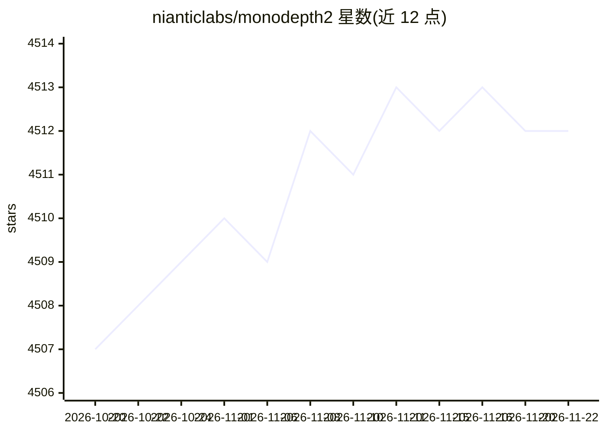

# nianticlabs/monodepth2

⭐ 4,512 · Jupyter Notebook · NOASSERTION · 推送 2026-11-02 · [GitHub](https://github.com/nianticlabs/monodepth2) · 组织维护

**单目图像深度估计的 PyTorch 参考实现（ICCV 2019 论文配套代码）**

论文《Digging into Self-Supervised Monocular Depth Estimation》的官方 PyTorch 实现，提供单张图像的视差/深度预测命令，附带多种分辨率的预训练模型下载。支持基于 KITTI 数据集的 mono/stereo/mono+stereo 三种模态训练、微调、KITTI 深度与位姿评估，并可下载预计算的视差结果。代码声明仅限非商业用途。使用 conda/pip 安装 PyTorch 等依赖，实验基于单 GPU 环境。

## 筛选速览

| 维度 | 判定 | 备注 |
|---|---|---|
| AI 角色 | `ai-native` | 本体是模型或模型工具 |
| 许可风险 | `none` | NOASSERTION |
| 部署形态 | `library` | 以包/库形式分发 |
| 模型依赖 | — | README 未给出锁定关系 |
| 硬件要求 | — | 无带数字的原话,不猜 |
| 安装摩擦 | `medium` | 含编译或系统依赖之一 |
| 成熟度 | — | 结构信号不足 |

## 能力要点

- 单张图像即可预测缩放视差或度量深度（--pred_metric_depth）
- 提供 9 个预训练模型及 ResNet 50 变体下载
- 支持自定义数据集训练（继承 MonoDataset 类）
- 附 KITTI 深度/里程计评估与预计算结果下载

## 适用场景

- 对单张图像估计深度/视差
- 在 KITTI 或自定义数据集上复现论文训练
- 评估自有方法的外部视差结果

## 场景标签

`模型训练` · 领域:训练与推理

## 证据(README 行号)

> L3: This is the reference PyTorch implementation for training and testing depth estimation models using the method descr
> L5: > **Digging into Self-Supervised Monocular Depth Estimation**
> L35: ## 🖼️ Prediction for a single image

## 星数曲线

2026-10-20 4,507 → 2026-11-22 4,512（+5）

---
*卡片 v1 · prompt 1.4 · 生成 2026-11-22 · 置信度 high · 依据 README sha `74ec3f2c19b7` · [字段定义](../../DATASET.md)*
