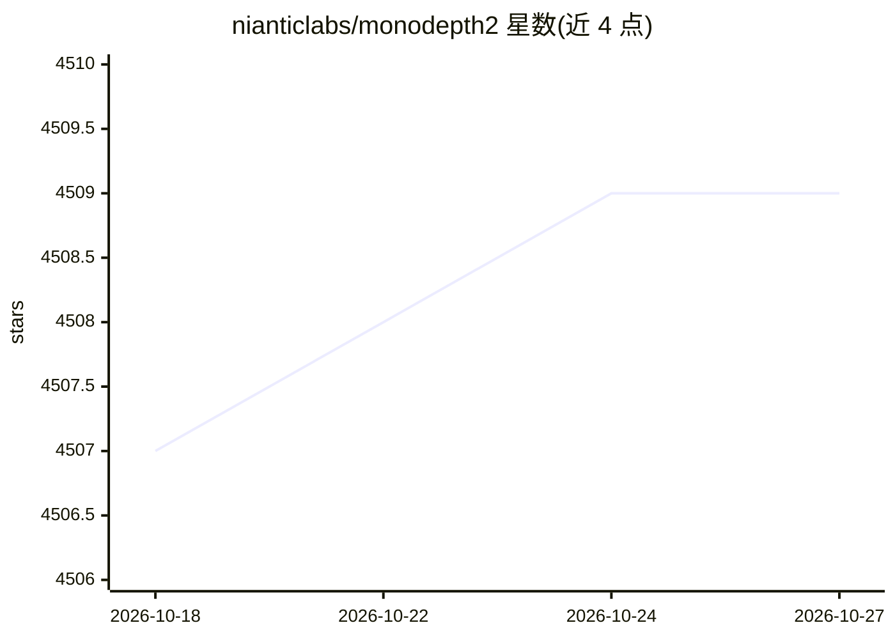

# nianticlabs/monodepth2

⭐ 4,509 · Jupyter Notebook · NOASSERTION · 推送 2026-10-05 · [GitHub](https://github.com/nianticlabs/monodepth2) · 组织维护

**单目深度估计的 PyTorch 训练/测试参考实现（ICCV 2019）**

Niantic 团队发布的 Monodepth2 论文（ICCV 2019）官方 PyTorch 参考实现，做自监督单目深度预测：从单张图像预测视差/深度，支持单目、双目及单目+双目三种训练模态，并包含位姿预测与 KITTI 基准评测代码。提供 9 组预训练模型（首次运行自动下载）、单图推理脚本、微调选项与预计算视差结果下载。面向科研复现与自定义数据集训练。限制：仅支持单 GPU 训练，KITTI 原始数据约 175GB，代码为非商业用途许可。

## 筛选速览

| 维度 | 判定 | 备注 |
|---|---|---|
| AI 角色 | `ai-native` | 本体是模型或模型工具 |
| 许可风险 | `none` | NOASSERTION |
| 部署形态 | `library` | 以包/库形式分发 |
| 模型依赖 | — | README 未给出锁定关系 |
| 硬件要求 | — | 无带数字的原话,不猜 |
| 安装摩擦 | `medium` | 含编译或系统依赖之一 |
| 成熟度 | — | 结构信号不足 |

## 能力要点

- 单目/双目/单目+双目三种自监督训练模态
- 单图推理脚本与 9 组预训练模型自动下载
- KITTI 深度与里程计基准评测代码及预计算结果
- 支持继承 MonoDataset 训练自定义数据集与微调

## 适用场景

- 复现 Monodepth2 论文的自监督深度估计训练与评测
- 用预训练模型对单张图像快速预测深度/视差
- 在自定义单目或双目数据集上训练深度模型

## 场景标签

`模型训练` · 领域:训练与推理

## 证据(README 行号)

> L3: This is the reference PyTorch implementation for training and testing depth estimation models using the method descr
> L40: python test_simple.py --image_path assets/test_image.jpg --model_name mono+stereo_640x192

## 星数曲线

2026-10-18 4,507 → 2026-10-27 4,509（+2）

---
*卡片 v1 · prompt 1.4 · 生成 2026-10-21 · 置信度 mid · 依据 README sha `188e248f1085` · [字段定义](../../DATASET.md)*
