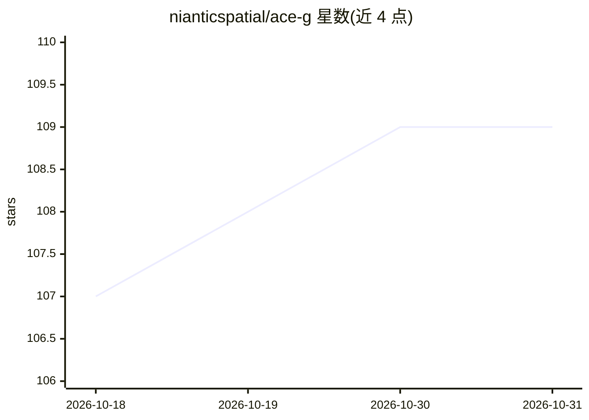

# nianticspatial/ace-g

⭐ 109 · Python · NOASSERTION · 推送 2026-02-20 · [GitHub](https://github.com/nianticspatial/ace-g) · [官网](https://nianticspatial.github.io/ace-g/) · 组织维护

**ICCV 2025 场景坐标回归视觉重定位的架构与预训练方案**

Niantic 空间团队发布的 ICCV 2025 论文官方代码：ACE-G 通过查询预训练改进场景坐标回归（SCR）视觉重定位的泛化能力。提供对新颖场景求取 map code、图像重定位、结果可视化与论文结果复现的代码；提供 pixi 环境一键运行示例，也支持手动 pip 安装并下载预训练模型。限制：预训练代码暂无发布计划，仅提供论文所用预训练模型；示例默认需 21GB 显存，可通过减小 buffer/batch size 降低。

## 筛选速览

| 维度 | 判定 | 备注 |
|---|---|---|
| AI 角色 | `ai-native` | 本体是模型或模型工具 |
| 许可风险 | `none` | NOASSERTION |
| 部署形态 | `library` | 以包/库形式分发 |
| 模型依赖 | — | README 未给出锁定关系 |
| 硬件要求 | — | 无带数字的原话,不猜 |
| 安装摩擦 | `low` | 无编译、无系统依赖或容器化 |
| 成熟度 | — | 结构信号不足 |

## 能力要点

- 对新颖场景训练 map code 并对查询图像估计相机位姿
- 提供预训练模型（ace_g_pretrained.pt）下载
- pixi 环境单命令运行映射+重定位示例
- 基于 Rerun 的数据集/映射/重定位可视化

## 适用场景

- 在新场景中建图并对查询图像做视觉重定位
- 复现论文在 7Scenes/12Scenes/Cambridge 等数据集的结果
- 研究场景坐标回归方法的泛化改进

## 场景标签

 · 领域:计算机视觉/空间计算

## 证据(README 行号)

> L1: # ACE-G: Improving Scene Coordinate Regression Through Query Pre-Training
> L7: This repository contains the code for "ACE-G: Improving Scene Coordinate Regression Through Query Pre-Training". For

## 星数曲线

2026-10-18 107 → 2026-10-31 109（+2）

---
*卡片 v1 · prompt 1.4 · 生成 2026-10-23 · 置信度 high · 依据 README sha `bc16be34b1d9` · [字段定义](../../DATASET.md)*
