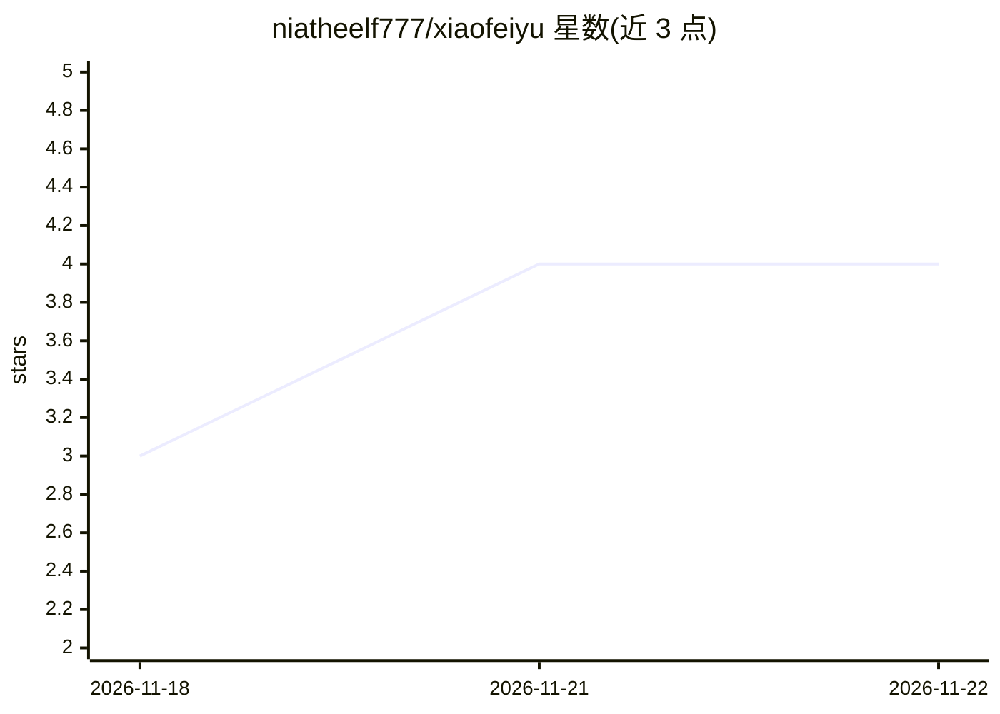

# niatheelf777/xiaofeiyu

⭐ 4 · Python · NOASSERTION · 推送 2026-11-17 · [GitHub](https://github.com/niatheelf777/xiaofeiyu) · [官网](https://xfy.tospeak.top) · 个人维护 · 中文 README

**本地运行 Gemma 人格气泡对话引擎：保留原始智力同时输出真人短气泡口吻**

面向 Gemma 模型的分阶段人格方案：推理、代码生成与工具调用阶段以 LoRA=0 原生权重运行，仅在输出 IM 气泡区间注入 5 枚轻量 LoRA 性能卡带（元气日常/甜系软萌/知性姐姐/傲娇毒舌/安静慢热），通过 OpenAI 兼容接口以 model 名中的五滑条权重实时混音，无需重启。按显存分三档预设：16GB+ 用 Q8_0 底模挂 LoRA、12GB 用 imatrix 动态量化、6-8GB 保留云端大脑由本地 4B 声带改写口吻。提供内置二维性格球 Web UI、Colab 免费试玩与 DSH 插件安装器。

## 筛选速览

| 维度 | 判定 | 备注 |
|---|---|---|
| AI 角色 | `ai-native` | 本体是模型或模型工具 |
| 许可风险 | `none` | NOASSERTION |
| 部署形态 | `library` | 以包/库形式分发 |
| 模型依赖 | local-ok | 支持本地模型 |
| 硬件要求 | `gpu-8g` | |
| 安装摩擦 | `low` | 无编译、无系统依赖或容器化 |
| 成熟度 | — | 结构信号不足 |

## 能力要点

- Split-Phase 脑声解耦：思考/代码阶段零 LoRA，气泡区间实时注入人格权重
- 五滑条无重启混音，单请求经 model 名权重参数切换性格
- OpenAI 兼容接口 + 内置二维性格球 Web UI + DSH 插件可逆安装
- 三档显存预设含 6-8GB 小显存云端大脑 + 本地 4B 声带方案

## 适用场景

- 想在本地显卡上跑带人格口吻的陪伴聊天
- 在 Cursor/DSH 等 OpenAI 客户端里接入短气泡风格对话
- 12GB 显存设备用特制量化版体验完整功能
- Colab 免费 T4 上零门槛试玩

## 场景标签

`聊天机器人` `微调` `模型量化` · 领域:对话与助手

## 证据(README 行号)

> L1: # 小肥鱼 (Xiaofeiyu) · Split-Phase 五滑条口语外挂与气泡对话引擎
> L7: 小肥鱼是一套面向 Gemma 4 的**低侵入式口语声带与五滑条人格混音方案**：推理思考、代码生成与工具调用全程以零 LoRA（`LoRA = 0.0`）原生运行，仅在输出微信/IM 对话气泡的 `<|"|>` 区间实时注入轻量化
> L82: 基于共享日常底座（`s0`）与四枚正交解耦的性格卡带（`c1..c4`），无需切换模型或重启服务，单个 OpenAI 兼容请求即可通过 `model="xiaofeiyu-v4|w0,w1,w2,w3,w4"` 在连续权重空间自由

## 星数曲线

2026-11-18 3 → 2026-11-22 4（+1）

---
*卡片 v1 · prompt 1.4 · 生成 2026-11-21 · 置信度 high · 依据 README sha `959f9a9446b4` · [字段定义](../../DATASET.md)*
