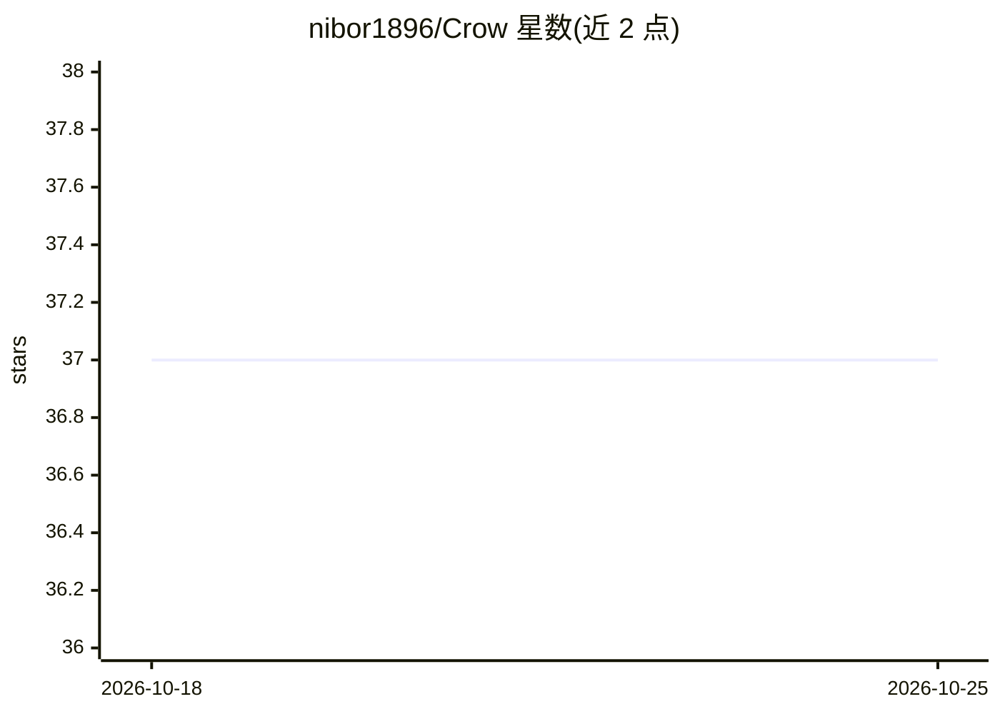

# nibor1896/Crow

⭐ 37 · Python · MIT · 推送 2026-10-23 · [GitHub](https://github.com/nibor1896/Crow) · [官网](https://github.com/nibor1896/Crow/releases/latest) · 个人维护

**本地运行的 AI agent：31 工具、MCP、记忆与图像生成**

面向本地优先用户的开源 AI agent 应用（Crow v4.3.0），提供 31 个工具、MCP 支持、记忆、技能、目标、子代理、浏览器面板、视觉与使用面板，并集成 Qwen-Image 2.1 的图像生成与编辑。模型经 crow-nest 引擎或 llama.cpp 在单 GPU 上运行，也可通过 OpenRouter 使用任意模型；可选接入 Claude 订阅（Claude Code 登录，Crow 不接触 token）。提供 Linux/Windows 安装脚本与安装包，Linux 单窗口模式需 gtk3、webkit2gtk-4.1、python-gobject。图像模型为 Qwen Research License 非商业许可。

## 筛选速览

| 维度 | 判定 | 备注 |
|---|---|---|
| AI 角色 | `ai-native` | 本体是模型或模型工具 |
| 许可风险 | `permissive` | MIT |
| 部署形态 | `desktop` | 安装包/桌面程序 |
| 模型依赖 | local-ok | 支持本地模型 |
| 硬件要求 | — | 无带数字的原话,不猜 |
| 安装摩擦 | `low` | 无编译、无系统依赖或容器化 |
| 成熟度 | — | 结构信号不足 |

## 能力要点

- 31 个工具、MCP、记忆、技能、目标、子代理与浏览器面板
- 200k 上下文的本地模型，经 crow-nest 或 llama.cpp 单 GPU 运行
- Qwen-Image 2.1 图像生成与编辑（可选构建 sd-server）
- 可选 Claude 订阅接入，token 不经过 Crow

## 适用场景

- 在本地 GPU 上运行带工具调用的 agent 完成任务
- 生成与编辑图像（Qwen-Image 2.1）
- 通过 OpenRouter 或 Claude 订阅使用云端模型

## 场景标签

`AI 助手` `图像生成` · 领域:对话与助手

## 证据(README 行号)

> L1: Crow v4.3.0: an agent, not a chat box. A local model at 200k context with 31 tools and MCP, memory, skills, goals, s
> L50: Images: Qwen-Image 2.1 (Qwen Research License, non-commercial) ·

## 星数曲线

2026-10-18 37 → 2026-10-25 37（+0）

---
*卡片 v1 · prompt 1.4 · 生成 2026-10-25 · 置信度 mid · 依据 README sha `cd1b6d3b1271` · [字段定义](../../DATASET.md)*
