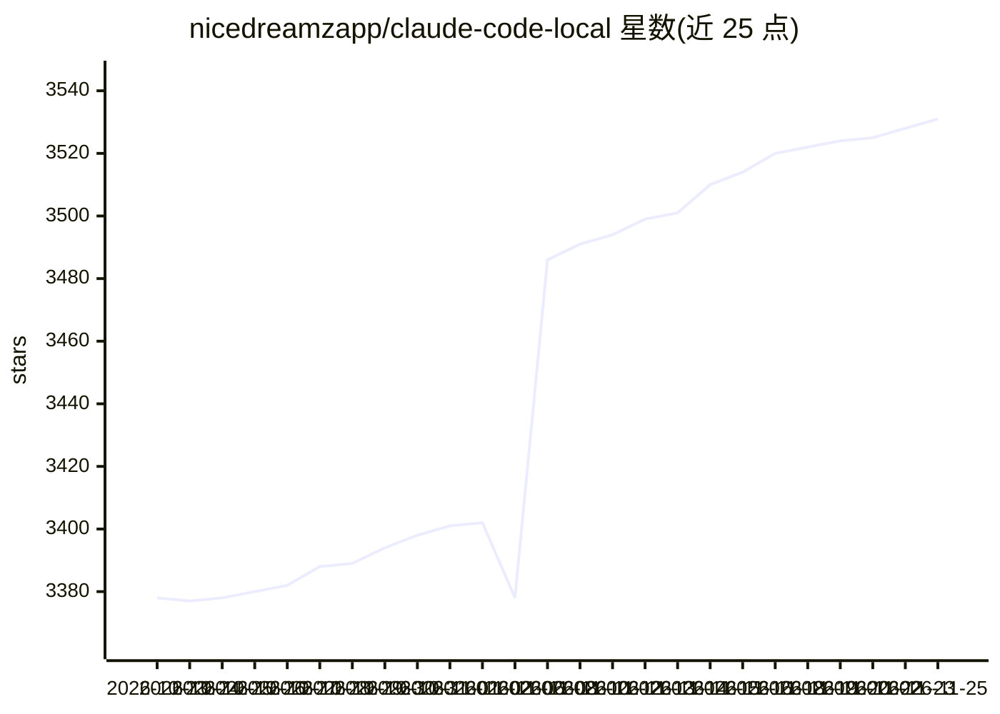

# nicedreamzapp/claude-code-local

⭐ 3,531 · Python · MIT · 推送 2026-11-23 · [GitHub](https://github.com/nicedreamzapp/claude-code-local) · [官网](https://nicedreamzapp.github.io/claude-code-local/) · 个人维护

**让 Claude Code 在用量耗尽后无缝切换本地模型继续工作的代理服务器**

核心是一个 Python 代理服务器（proxy/server.py），用 Apple MLX 在本机运行开源模型，并以 Anthropic Messages API 格式（含流式与工具调用 JSON 修复）响应 Claude Code，无需 API key。配套 keepgoing 命令把上一次 Claude Code 会话续接到本地或 OpenRouter 免费云端模型；安装脚本按 Mac 内存自动选型，从 8 GB 到 96 GB 分五档。Linux/Windows 走 llama.cpp。附语音、浏览器、手机等可选 add-on。

## 筛选速览

| 维度 | 判定 | 备注 |
|---|---|---|
| AI 角色 | `ai-ecosystem` | LLM/agent 周边工具 |
| 许可风险 | `permissive` | MIT |
| 部署形态 | `library` | 以包/库形式分发 |
| 模型依赖 | local-ok | 支持本地模型 |
| 硬件要求 | `cpu-ok` | |
| 安装摩擦 | `low` | 无编译、无系统依赖或容器化 |
| 成熟度 | — | 结构信号不足 |

## 能力要点

- 代理服务器直接说 Anthropic API 格式，中间无转换层
- keepgoing 命令续接上次 Claude Code 会话到本地或免费云模型
- 按 Mac 内存自动选模型（8 GB–96 GB 五档）
- 附带语音交互、浏览器 agent、iPhone 控制等可选 add-on

## 适用场景

- Claude Code 用量到限后想继续在本地模型上干活
- 代码不出本机的离线编程工作流
- 在小内存 MacBook（8/16 GB）上跑本地编码助手

## 场景标签

`编码 Agent` `推理引擎` · 领域:编码与开发

## 证据(README 行号)

> L46: **In one sentence:** a small Python server (`proxy/server.py`) runs open AI models on your Mac's chip with Apple's 
> L53:  01. What I built. The glue that makes local models usable inside Claude Code
> L58: - ⚡ **`proxy/server.py`**: the MLX server. Speaks the Anthropic Messages API with streaming, turns each model's own

## 星数曲线

2026-10-23 3,378 → 2026-11-25 3,531（+153）

---
*卡片 v1 · prompt 1.4 · 生成 2026-11-25 · 置信度 mid · 依据 README sha `4c11eb5a1c49` · [字段定义](../../DATASET.md)*
