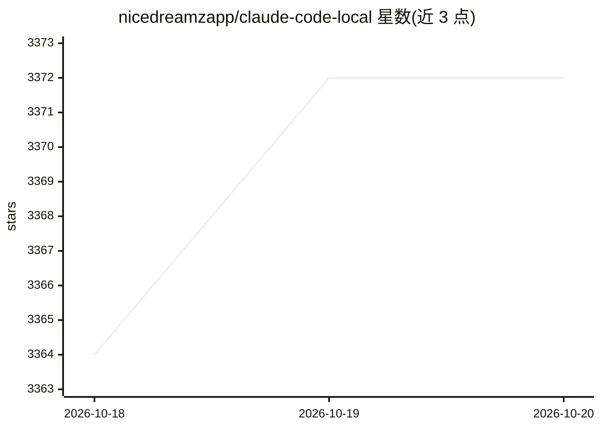

# nicedreamzapp/claude-code-local

⭐ 3,372 · Python · MIT · 推送 2026-10-15 · [GitHub](https://github.com/nicedreamzapp/claude-code-local) · [官网](https://www.youtube.com/@nicedreamzapps) · 个人维护

**在 Apple Silicon Mac 上本地运行开源模型驱动 Claude Code 的 MLX 服务器**

一个 Python 服务器（proxy/server.py），用 Apple MLX 在 Mac 芯片上运行 Qwen、Gemma、Hermes 等开源模型，并以 Anthropic Messages API 格式（含流式）响应 Claude Code，使其无需云端模型与 API key 即可工作；服务器将各模型自身的工具调用格式转换为 Claude Code 工具调用，修复损坏的工具 JSON，并在多轮间复用 prompt cache。附 install.sh/setup.sh 按内存自动选模型安装，并提供命令行 Agent、会话续接（keep going）与浏览器/语音/手机等配套模式。需要 Apple Silicon（M1 及以上）Mac 与 Python 3.12。

## 筛选速览

| 维度 | 判定 | 备注 |
|---|---|---|
| AI 角色 | `ai-ecosystem` | LLM/agent 周边工具 |
| 许可风险 | `permissive` | MIT |
| 部署形态 | `library` | 以包/库形式分发 |
| 模型依赖 | — | README 未给出锁定关系 |
| 硬件要求 | — | 无带数字的原话,不猜 |
| 安装摩擦 | `low` | 无编译、无系统依赖或容器化 |
| 成熟度 | — | 结构信号不足 |

## 能力要点

- MLX 服务器直接以 Anthropic Messages API 格式响应 Claude Code，无中间转换层
- 将 Gemma/Qwen/Llama 等模型的工具调用格式转换为 Claude Code 工具调用并修复损坏 JSON
- setup.sh 按 Mac 内存自动选择并下载适配模型，可在 16GB 内存机型运行
- keep going 命令可在 Claude 额度用尽后用本地或免费云模型续接同一会话

## 适用场景

- 在 Mac 上离线、无 API key 地使用 Claude Code 编码
- NDA/法律等隐私要求下本地运行 AI 编码助手
- Claude 用量限额后用本地模型继续同一会话

## 场景标签

`编码 Agent` `推理引擎` · 领域:编码与开发

## 证据(README 行号)

> L17: **In one sentence:** a small Python server (`proxy/server.py`) runs open AI models on your Mac's chip with Apple's 
> L28: - ⚡ **`proxy/server.py`**: the MLX server. Speaks the Anthropic Messages API with streaming, turns each model's own
> L91: Your Mac has a powerful graphics chip built in. This project uses it to run **big AI models right on

## 星数曲线

2026-10-18 3,364 → 2026-10-20 3,372（+8）

---
*卡片 v1 · prompt 1.4 · 生成 2026-10-20 · 置信度 mid · 依据 README sha `478ccf393054` · [字段定义](../../DATASET.md)*
