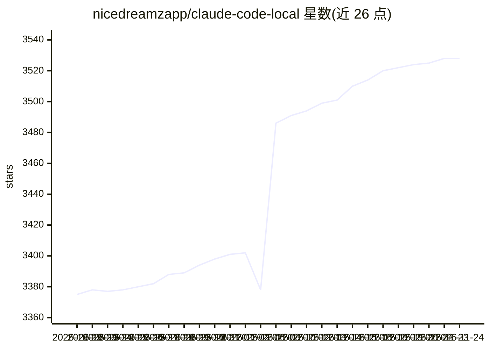

# nicedreamzapp/claude-code-local

⭐ 3,528 · Python · MIT · 推送 2026-11-22 · [GitHub](https://github.com/nicedreamzapp/claude-code-local) · [官网](https://nicedreamzapp.github.io/claude-code-local/) · 个人维护

**让 Claude Code 在用量用尽后继续跑本地模型的代理服务器**

一个 Python 代理服务器（proxy/server.py），用 Apple MLX（Mac）或 llama.cpp（Linux/Windows）在本地运行开源模型，并以 Anthropic Messages API 格式（含流式与工具调用格式转换）响应 Claude Code，使其无需 API key 和云端模型即可继续工作。配套 keepgoing 命令可在 Claude Code 用量用尽后接着上次会话切换到本地或 OpenRouter 免费云模型；安装脚本按内存自动选模型，最小可在 8/16 GB 内存机器运行。

## 筛选速览

| 维度 | 判定 | 备注 |
|---|---|---|
| AI 角色 | `ai-ecosystem` | LLM/agent 周边工具 |
| 许可风险 | `permissive` | MIT |
| 部署形态 | `library` | 以包/库形式分发 |
| 模型依赖 | local-ok | 支持本地模型 |
| 硬件要求 | — | 无带数字的原话,不猜 |
| 安装摩擦 | `low` | 无编译、无系统依赖或容器化 |
| 成熟度 | — | 结构信号不足 |

## 能力要点

- 代理服务器直接以 Anthropic Messages API 格式响应 Claude Code，含流式与工具调用 JSON 修复
- keepgoing 命令可恢复上次 Claude Code 会话到本地或 OpenRouter 免费云模型
- 安装脚本按 Mac 内存自动匹配模型（8 GB 至 96+ GB 分档）
- 提供 Doctor 诊断脚本检查 Claude Code、模型服务器、Python、llama.cpp 等组件

## 适用场景

- Claude Code 5 小时/每周用量用尽后继续在本地模型上工作
- 离线或无 API key 环境下使用 Claude Code 编程
- 在 8/16 GB 小内存 Mac 上运行本地编码助手

## 场景标签

`模型网关` · 领域:Agent 开发

## 证据(README 行号)

> L46: **In one sentence:** a small Python server (`proxy/server.py`) runs open AI models on your Mac's chip with Apple's 
> L58: - ⚡ **`proxy/server.py`**: the MLX server. Speaks the Anthropic Messages API with streaming, turns each model's own
> L61: - 🔋 **`bin/keepgoing`** + `bin/keepgoing.py`: finds your last Claude Code conversation in this folder and resumes i

## 星数曲线

2026-10-22 3,375 → 2026-11-24 3,528（+153）

---
*卡片 v1 · prompt 1.4 · 生成 2026-11-23 · 置信度 mid · 依据 README sha `58b34598a8bb` · [字段定义](../../DATASET.md)*
