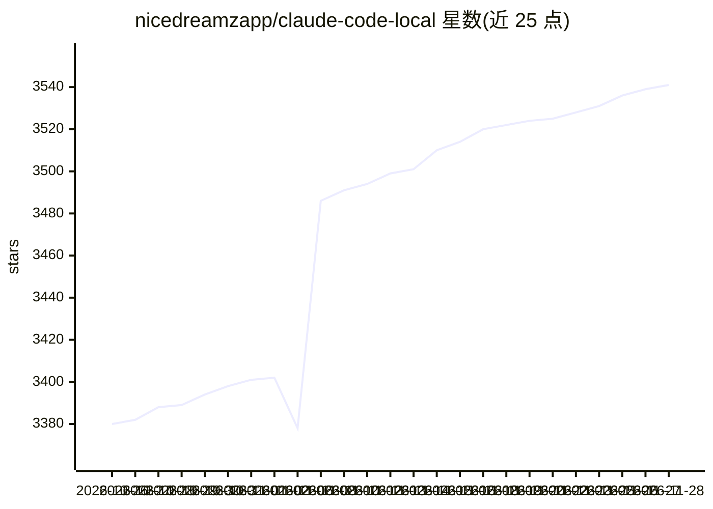

# nicedreamzapp/claude-code-local

⭐ 3,541 · Python · MIT · 推送 2026-11-27 · [GitHub](https://github.com/nicedreamzapp/claude-code-local) · [官网](https://nicedreamzapp.github.io/claude-code-local/) · 个人维护

**让 Claude Code 在本地模型上继续运行的代理服务器**

一个 Python 代理服务器（proxy/server.py），用 Apple MLX（Mac）或 llama.cpp（Linux/Windows）在本地运行开源模型，并以 Anthropic Messages API 格式（含流式与工具调用 JSON 修复）响应 Claude Code，使 Claude Code 无需云模型和 API key 即可工作。附带的 keepgoing 命令可在用量限制触发后接续上一段对话；setup 按机器内存自动挑选模型档位。依赖 Claude Code、Python 3.12 与 Apple Silicon（Mac 端）。

## 筛选速览

| 维度 | 判定 | 备注 |
|---|---|---|
| AI 角色 | `ai-ecosystem` | LLM/agent 周边工具 |
| 许可风险 | `permissive` | MIT |
| 部署形态 | `library` | 以包/库形式分发 |
| 模型依赖 | local-ok | 支持本地模型 |
| 硬件要求 | — | 无带数字的原话,不猜 |
| 安装摩擦 | `low` | 无编译、无系统依赖或容器化 |
| 成熟度 | — | 结构信号不足 |

## 能力要点

- 服务器直接讲 Anthropic Messages API，Claude Code 无需翻译层即可接本地模型
- keepgoing 命令在用量限制后于本地或免费云模型上恢复同一对话
- 按 Mac 内存自动选择模型档位（8 GB 到 96 GB+ 分级）
- 可选 add-on：语音、浏览器 agent、手机远控等，各自独立仓库安装

## 适用场景

- Claude Code 用量到限后在本机继续同一编码任务
- 离线/隐私场景下让代码与对话不出本机
- Windows/Linux 上通过 llama.cpp 运行同样的本地编码流程

## 场景标签

`编码 Agent` · 领域:编码与开发

## 证据(README 行号)

> L46: **In one sentence:** a small Python server (`proxy/server.py`) runs open AI models on your Mac's chip with Apple's 
> L53:  01. What I built. The glue that makes local models usable inside Claude Code
> L7: **Claude Code, running on your own computer when your Claude usage runs out. Same tools, same project, no API key.**

## 星数曲线

2026-10-26 3,380 → 2026-11-28 3,541（+161）

---
*卡片 v1 · prompt 1.4 · 生成 2026-11-28 · 置信度 high · 依据 README sha `563a3912a057` · [字段定义](../../DATASET.md)*
