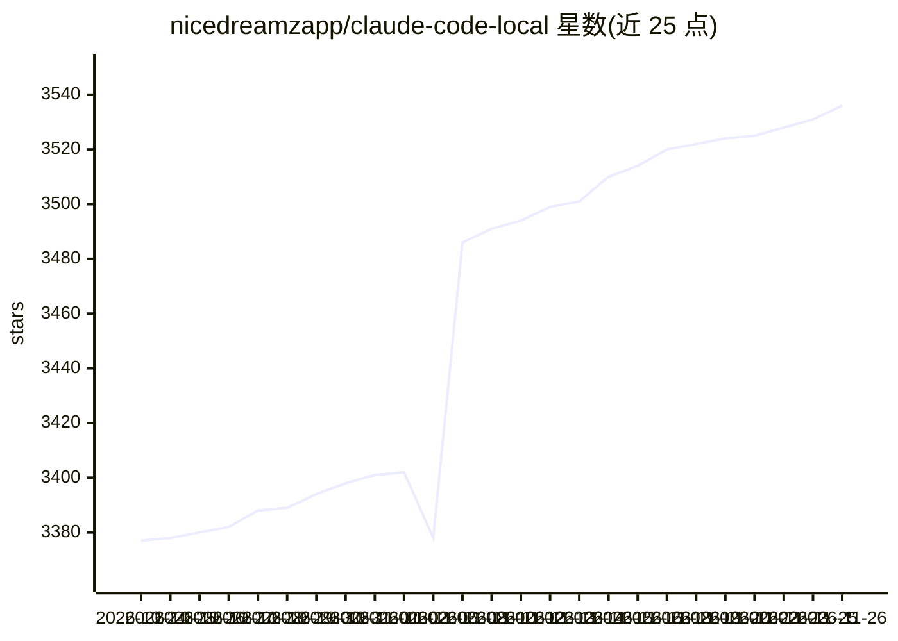

# nicedreamzapp/claude-code-local

⭐ 3,536 · Python · MIT · 推送 2026-11-25 · [GitHub](https://github.com/nicedreamzapp/claude-code-local) · [官网](https://nicedreamzapp.github.io/claude-code-local/) · 个人维护

**让 Claude Code 在本地模型上继续运行的代理服务器**

该项目是一个 Python 代理服务器（proxy/server.py），用 Apple MLX 在本机运行开源模型，并以 Anthropic Messages API 格式响应 Claude Code，使额度用尽后可在本地模型上继续同一对话，无需 API key。组件包括工具调用 JSON 解析修复、keepgoing 会话恢复脚本、单文件终端编码 Agent、按 Mac 内存自动选型的安装脚本与 Doctor 诊断脚本。支持 Apple Silicon（MLX）及 Linux/Windows（llama.cpp）；提供语音、浏览器、手机等可选附加组件。

## 筛选速览

| 维度 | 判定 | 备注 |
|---|---|---|
| AI 角色 | `ai-ecosystem` | LLM/agent 周边工具 |
| 许可风险 | `permissive` | MIT |
| 部署形态 | `library` | 以包/库形式分发 |
| 模型依赖 | local-ok | 支持本地模型 |
| 硬件要求 | — | 无带数字的原话,不猜 |
| 安装摩擦 | `low` | 无编译、无系统依赖或容器化 |
| 成熟度 | — | 结构信号不足 |

## 能力要点

- 代理服务器直接以 Anthropic Messages API 格式应答 Claude Code，支持流式与工具调用格式转换
- keepgoing 命令在本地或 OpenRouter 免费云端模型上恢复上次 Claude Code 会话
- 安装脚本按机器内存自动选择模型（8GB 至 96GB+ 分档）
- 提供 Doctor 诊断脚本检查 Claude Code、模型服务器、模型文件与 llama.cpp

## 适用场景

- Claude Code 用量达到限额时切换到本地模型继续任务
- 在无网络或不出内网的环境下离线使用 Claude Code
- 在同一项目会话中于 Claude 与本地模型之间来回切换

## 场景标签

`编码 Agent` · 领域:编码与开发

## 证据(README 行号)

> L46: **In one sentence:** a small Python server (`proxy/server.py`) runs open AI models on your Mac's chip with Apple's 
> L53:  01. What I built. The glue that makes local models usable inside Claude Code
> L58: - ⚡ **`proxy/server.py`**: the MLX server. Speaks the Anthropic Messages API with streaming, turns each model's own

## 星数曲线

2026-10-24 3,377 → 2026-11-26 3,536（+159）

---
*卡片 v1 · prompt 1.4 · 生成 2026-11-26 · 置信度 mid · 依据 README sha `ddb275c0a2d8` · [字段定义](../../DATASET.md)*
