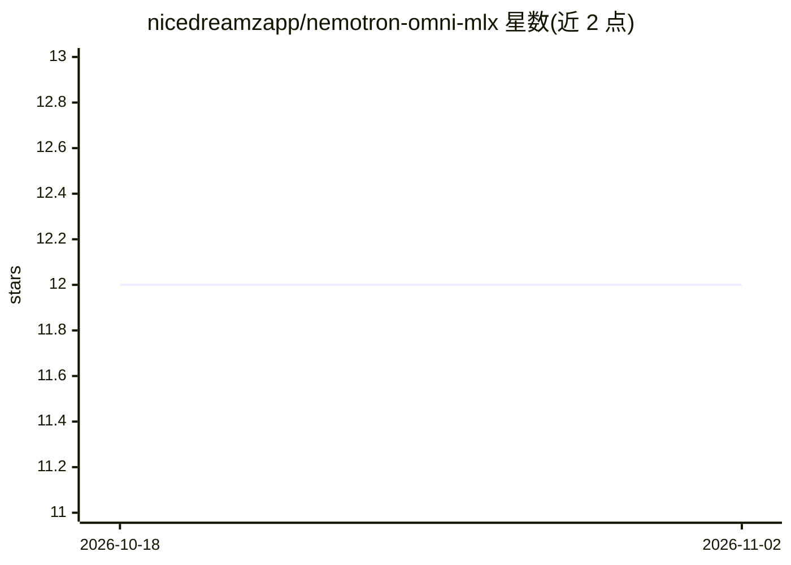

# nicedreamzapp/nemotron-omni-mlx

⭐ 12 · Python · MIT · 推送 2026-10-25 · [GitHub](https://github.com/nicedreamzapp/nemotron-omni-mlx) · [官网](https://nicedreamzwholesale.com/2026/07/16/nvidia-nemotron-omni-mlx-apple-silicon-vision-audio-runtime/) · 个人维护

**在 Apple Silicon 上纯 MLX 运行 NVIDIA 三模态 Nemotron Omni 模型**

将 NVIDIA Nemotron-3-Nano-Omni-30B-A3B 的视觉塔（C-RADIOv4-H）、音频塔（Parakeet Conformer）、处理器与 CLI 移植为纯 MLX 运行时，使该 4-bit 量化模型可在 Mac 上离线完成图像/视频/音频/文本推理。各组件经 23 项奇偶校验测试与 NVIDIA PyTorch 参考实现比对（余弦相似度 0.9999+）。要求 Apple Silicon 且 ≥32 GB 内存，32 GB 机型图像路径需调高 GPU 内存上限；仓库不含权重，需另行下载约 19 GB。另提供 abliterated 版本权重与 llama.cpp GGUF 转换说明。

## 筛选速览

| 维度 | 判定 | 备注 |
|---|---|---|
| AI 角色 | `ai-native` | 本体是模型或模型工具 |
| 许可风险 | `permissive` | MIT |
| 部署形态 | `library` | 以包/库形式分发 |
| 模型依赖 | — | README 未给出锁定关系 |
| 硬件要求 | — | 无带数字的原话,不猜 |
| 安装摩擦 | `low` | 无编译、无系统依赖或容器化 |
| 成熟度 | `idea` | |

## 能力要点

- 视觉/音频塔、处理器、CLI 全部移植为纯 MLX 并通过 23/23 奇偶校验
- 文本+图像+音频三模态离线推理（M5 Max 上图像 67.7 tok/s）
- 32 GB Mac 的 Metal 内存上限问题给出诊断脚本与 sysctl 修复方案
- 附带 abliterated 权重构建与 llama.cpp GGUF 转换补丁说明

## 适用场景

- 在无网络环境下用 MacBook 进行图像、视频、音频与文本理解
- 本地运行三模态 Omni 模型且不向云端发送数据
- 为 MLX 生态移植其他多模态模型时参考其踩坑记录

## 场景标签

`多模态` `推理引擎` · 领域:感知与多模态

## 证据(README 行号)

> L7: In plain terms: you give it a prompt plus an image, a video or an audio clip, and it answers in
> L57: - `src/omni.py`: the CLI that splices image, video and audio embeddings into the text backbone and generates.

## 星数曲线

2026-10-18 12 → 2026-11-02 12（+0）

---
*卡片 v1 · prompt 1.4 · 生成 2026-11-01 · 置信度 high · 依据 README sha `3d75839c4509` · [字段定义](../../DATASET.md)*
