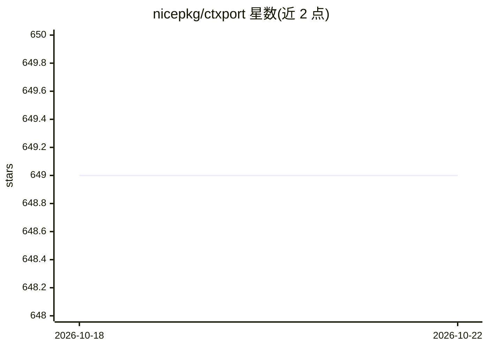

# nicepkg/ctxport

⭐ 651 · TypeScript · MIT · 推送 2026-03-04 · [GitHub](https://github.com/nicepkg/ctxport) · [官网](https://ctxport.xiaominglab.com) · 组织维护 · 中文 README

**浏览器扩展：一键把 AI 对话复制为结构化 Markdown**

面向 AI 对话用户的 Chrome（Manifest V3）浏览器扩展：在 ChatGPT、Claude、Gemini、DeepSeek、Grok、豆包、GitHub 页面内提供一键复制按钮、快捷键 Alt+Shift+C，以及侧栏悬停直接复制未打开的会话。输出带 frontmatter 元数据的 Context Bundle（Markdown），支持 Full/User Only/Code Only/Compact 四种格式。全程本地处理、零上传、无需账号。Chrome 商店版标注开发中，当前需 git clone 源码经 pnpm 构建后以未打包扩展加载。

## 筛选速览

| 维度 | 判定 | 备注 |
|---|---|---|
| AI 角色 | `ai-ecosystem` | LLM/agent 周边工具 |
| 许可风险 | `permissive` | MIT |
| 部署形态 | `library` | 以包/库形式分发 |
| 模型依赖 | locked-api |  |
| 硬件要求 | — | 无带数字的原话,不猜 |
| 安装摩擦 | `low` | 无编译、无系统依赖或容器化 |
| 成熟度 | `idea` | |

## 能力要点

- 支持 ChatGPT/Claude/Gemini/DeepSeek/Grok/豆包/GitHub 七个平台的一键复制
- 侧栏悬停复制会话，无需打开对话页面
- 带 frontmatter 元数据的 Context Bundle Markdown 格式，四种复制模式
- 零上传、本地处理、MIT 开源

## 适用场景

- 把 ChatGPT 里的方案讨论整理成 Markdown 贴给 Claude 继续实现
- 不打开会话就批量复制多个对话用于项目简报
- 只提取对话中的代码块用于存档或分享

## 场景标签

 · 领域:AI 工具/浏览器扩展

## 证据(README 行号)

> L18: ChatGPT
> L42: **CtxPort fixes this.** One click, and your entire conversation becomes a clean, structured Markdown document -- re
> L66:     A["AI Conversation (ChatGPT, Claude, etc.)"] --> B["CtxPort Browser Extension"]

## 星数曲线

2026-10-18 649 → 2026-10-22 649（+0）

---
*卡片 v1 · prompt 1.4 · 生成 2026-10-21 · 置信度 mid · 依据 README sha `d10c1aac310a` · [字段定义](../../DATASET.md)*
