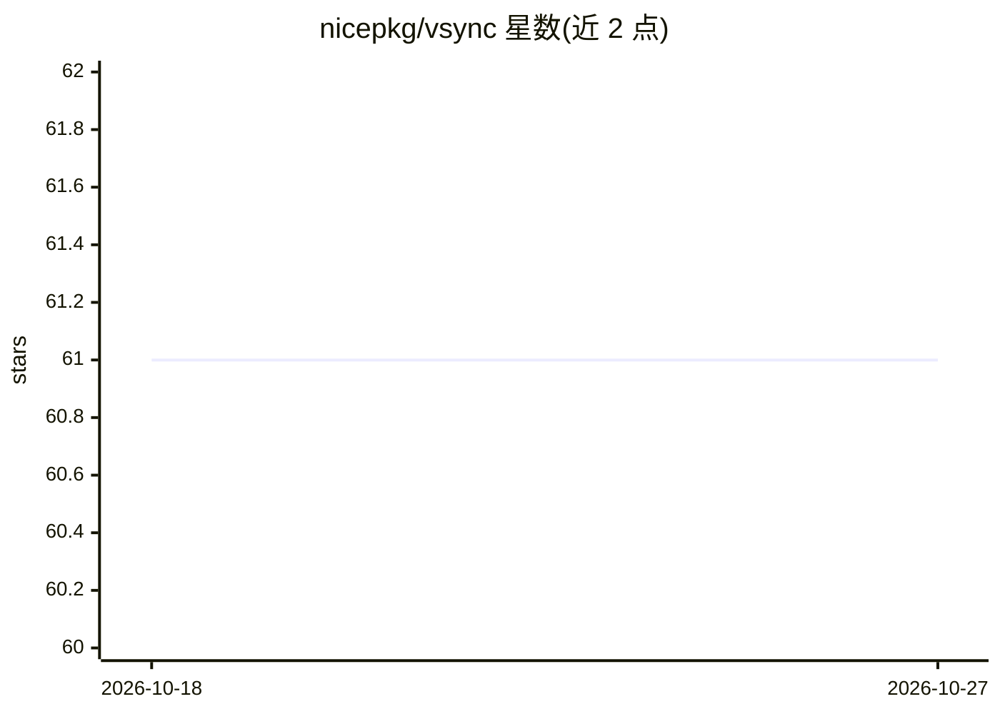

# nicepkg/vsync

⭐ 61 · TypeScript · MIT · 推送 2026-01-27 · [GitHub](https://github.com/nicepkg/vsync) · [官网](https://vsync.xiaominglab.com) · 组织维护 · 中文 README

**AI 编码工具配置同步 CLI：一份配置同步 Skills/MCP/Agents/Commands**

面向同时使用 Claude Code、Cursor、OpenCode、Codex 的开发者的 Node.js CLI 工具：指定一个工具为配置源，用 vsync sync 将 Skills、MCP servers、Agents、Commands 同步到其他工具，自动处理目录结构差异与 JSON/JSONC/TOML 格式转换及环境变量语法转换。提供 Safe（只增改不删）与 Prune（严格镜像）两种模式、diff 预览、原子写入、哈希清单缓存，支持项目级与用户级配置及导入导出。同步为单向（源→目标）。通过 npx 免安装运行，CLI 支持中英文。

## 筛选速览

| 维度 | 判定 | 备注 |
|---|---|---|
| AI 角色 | `ai-ecosystem` | LLM/agent 周边工具 |
| 许可风险 | `permissive` | MIT |
| 部署形态 | `library` | 以包/库形式分发 |
| 模型依赖 | — | README 未给出锁定关系 |
| 硬件要求 | — | 无带数字的原话,不猜 |
| 安装摩擦 | `low` | 无编译、无系统依赖或容器化 |
| 成熟度 | — | 结构信号不足 |

## 能力要点

- 指定单一源工具，一条命令同步 4 种 AI 编码工具的 Skills/MCP/Agents/Commands
- JSON/JSONC/TOML 格式与环境变量语法自动转换（保留 JSONC 注释，不展开变量）
- Safe 与 Prune 两种同步模式，diff 计划预览与原子写入
- 项目级与用户级配置、并行操作与基于哈希清单的缓存

## 适用场景

- 团队新成员一条命令对齐团队的 AI 编码工具配置
- 从 Cursor 迁移到 Claude Code 时迁移配置
- 在多个 AI 编码工具间保持统一的 Skills 与 MCP servers

## 场景标签

 · 领域:开发者工具/AI 编码工具链

## 证据(README 行号)

> L14: Managing Skills, MCP servers, Agents & Commands across multiple AI coding tools is a nightmare.
> L29: **The Solution**: vsync gives you one command to sync everything. Pick one tool as your source of truth, and all ot

## 星数曲线

2026-10-18 61 → 2026-10-27 61（+0）

---
*卡片 v1 · prompt 1.4 · 生成 2026-10-24 · 置信度 high · 依据 README sha `8a2a635c3a8b` · [字段定义](../../DATASET.md)*
