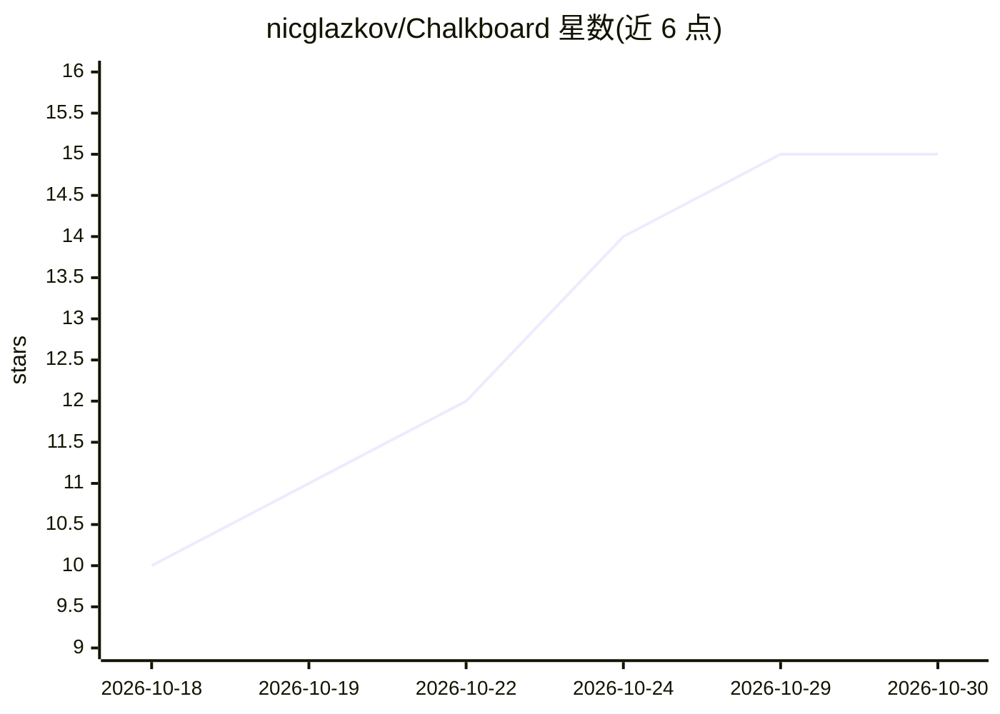

# nicglazkov/Chalkboard

⭐ 15 · Python · MIT · 推送 2026-10-23 · [GitHub](https://github.com/nicglazkov/Chalkboard) · [官网](https://chalkboard.studio/) · 个人维护

**自托管流水线：把一个主题生成为带旁白的 LaTeX 级数学讲解视频**

在自有机器上运行的多阶段流水线：输入主题及可选的文件、URL 或 GitHub 仓库，由 Claude 代理写脚本并做事实核查，基于内置设计系统生成 Manim 场景，经语法/AST 检查与无头布局预检后渲染，再用 ElevenLabs、本地 Kokoro 或 OpenAI TTS 录制逐词同步旁白，最后由 Claude 审查成片帧。各阶段有检查点与失败重试。通过 Web UI、CLI、REST API 或 Python SDK 驱动。需要 Anthropic API key，1-2 分钟视频的 Claude 用量约 $0.40-$1；提供 Docker 一键部署或 macOS/Linux 原生安装（原生安装需 ffmpeg、LaTeX 等系统依赖）。

## 筛选速览

| 维度 | 判定 | 备注 |
|---|---|---|
| AI 角色 | `ai-native` | 本体是模型或模型工具 |
| 许可风险 | `permissive` | MIT |
| 部署形态 | `self-host` | docker 或自建部署 |
| 模型依赖 | locked-api |  |
| 硬件要求 | — | 无带数字的原话,不猜 |
| 安装摩擦 | `low` | 无编译、无系统依赖或容器化 |
| 成熟度 | — | 结构信号不足 |

## 能力要点

- Claude 代理流水线：写脚本、事实核查、生成 Manim 场景、渲染后帧审查
- 真实 LaTeX 排版公式（共享导言区与 Computer Modern 字体）与场景设计系统
- 逐词同步旁白：ElevenLabs Aria/Milo、免费本地 Kokoro 或 OpenAI TTS
- Web UI / CLI / REST API / Python SDK 四种驱动方式，Docker 一键部署

## 适用场景

- 把数学或科学主题自动做成带旁白的讲解视频
- 基于自己的 PDF、代码库或论文生成讲解视频
- 在自有机器上批量生成并检索管理讲解视频库

## 场景标签

`视频生成` `多智能体` · 领域:Agent 开发

## 证据(README 行号)

> L3:  Turn a topic into a narrated, LaTeX-quality math and science explainer video.
> L24: Chalkboard is a pipeline of Claude agents built on LangGraph. Give it a topic, and optionally files, URLs or a GitH

## 星数曲线

2026-10-18 10 → 2026-10-30 15（+5）

---
*卡片 v1 · prompt 1.4 · 生成 2026-10-30 · 置信度 high · 依据 README sha `9017f5dc2418` · [字段定义](../../DATASET.md)*
