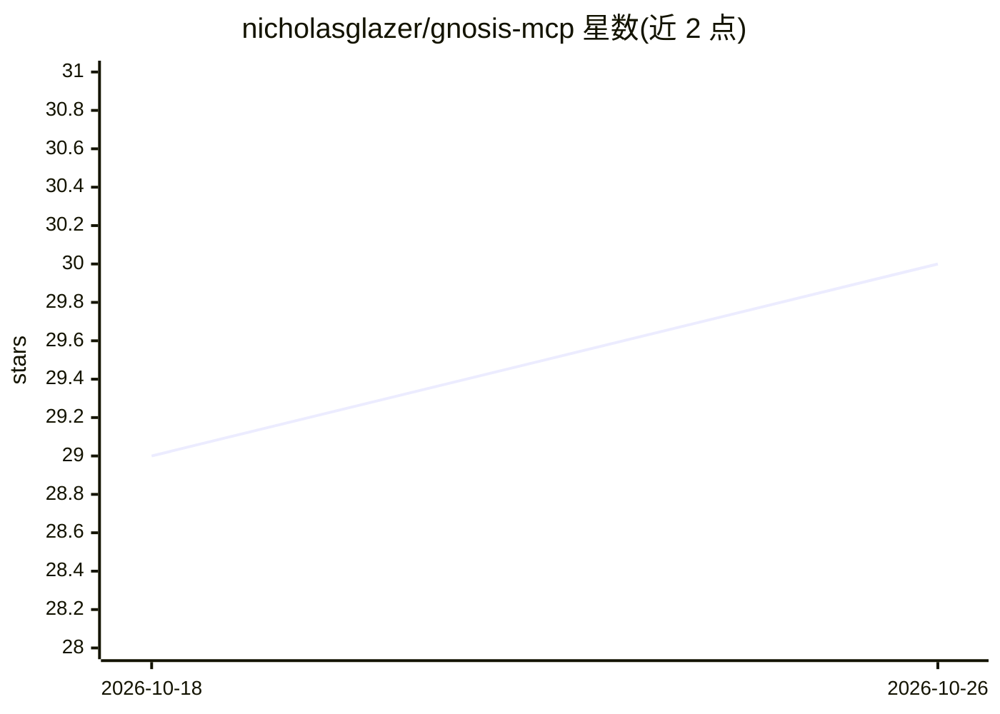

# nicholasglazer/gnosis-mcp

⭐ 30 · Python · MIT · 推送 2026-10-15 · [GitHub](https://github.com/nicholasglazer/gnosis-mcp) · [官网](https://gnosismcp.com) · 个人维护

**零配置的本地文档搜索 MCP 服务器，供 AI agent 检索自有文档**

面向开发者与 AI agent 使用者的 MCP 服务器：将 Markdown、git 提交历史、爬取的网页等文档摄取进本地索引（默认 SQLite，可选 PostgreSQL/pgvector），通过 search_docs 等 9 个 MCP 工具返回带高亮的少量片段，替代整文件粘贴进上下文。搜索为 BM25 关键词加可选本地 ONNX 语义嵌入的混合模式（RRF 融合），重排序默认关闭。提供 CLI、REST API、Docker 多架构镜像与访问日志/节省统计，写入工具需环境变量显式开启。

## 筛选速览

| 维度 | 判定 | 备注 |
|---|---|---|
| AI 角色 | `ai-ecosystem` | LLM/agent 周边工具 |
| 许可风险 | `permissive` | MIT |
| 部署形态 | `self-host` | docker 或自建部署 |
| 模型依赖 | local-ok | 支持本地模型 |
| 硬件要求 | — | 无带数字的原话,不猜 |
| 安装摩擦 | `low` | 无编译、无系统依赖或容器化 |
| 成熟度 | — | 结构信号不足 |

## 能力要点

- SQLite 默认零配置，PostgreSQL/pgvector 可选扩展
- BM25+本地 ONNX 嵌入混合搜索，无需 API key
- 摄取 git 提交历史与网页爬取的文档，支持 watch 自动重建索引
- 内置可复现评测命令 gnosis-mcp eval 与 token 节省统计

## 适用场景

- 让 Claude Code、Cursor 等 MCP 客户端直接搜索我的本地项目文档
- 把团队文档建成本地可检索索引，避免每次粘贴整个文件
- 追踪 agent 实际查询了哪些文档、哪些查询未命中

## 场景标签

`语义搜索` · 领域:知识与检索

## 证据(README 行号)

> L17: Gnosis MCP — ingest docs, search, view stats, serve
> L181: Gnosis MCP exposes nine tools and three resources over MCP. Your AI agent calls these automatically when it needs 

## 星数曲线

2026-10-18 29 → 2026-10-26 30（+1）

---
*卡片 v1 · prompt 1.4 · 生成 2026-10-26 · 置信度 high · 依据 README sha `12246d683947` · [字段定义](../../DATASET.md)*
