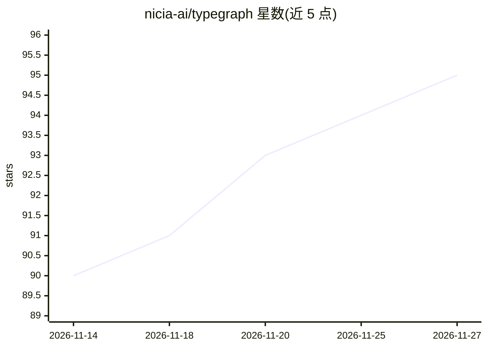

# nicia-ai/typegraph

⭐ 95 · TypeScript · MIT · 推送 2026-11-26 · [GitHub](https://github.com/nicia-ai/typegraph) · [官网](https://typegraph.dev) · 组织维护

**嵌入 SQLite/PostgreSQL 的 TypeScript 知识图谱库，供 Agent 记忆与 RAG 建模**

TypeScript 嵌入式属性图谱库：在现有 SQLite 或 PostgreSQL 数据库上以 Zod 定义节点与边，通过流式 TypeScript API 进行编译期类型安全的遍历查询，支持 subClassOf/implies/inverseOf/disjointWith 等本体原语、向量与全文混合检索（pgvector、sqlite-vec、libSQL/Turso）、双时态历史读取，以及从 agent 提出的 JSON 在运行时演化 schema。明确不面向分布式图处理与十亿级图。面向需要图语义但不引入独立图服务的开发者，以 npm 包分发，MIT 许可。

## 筛选速览

| 维度 | 判定 | 备注 |
|---|---|---|
| AI 角色 | `ai-ecosystem` | LLM/agent 周边工具 |
| 许可风险 | `permissive` | MIT |
| 部署形态 | `library` | 以包/库形式分发 |
| 模型依赖 | — | README 未给出锁定关系 |
| 硬件要求 | — | 无带数字的原话,不猜 |
| 安装摩擦 | `low` | 无编译、无系统依赖或容器化 |
| 成熟度 | — | 结构信号不足 |

## 能力要点

- 图数据留在现有 SQL 数据库，无需独立图服务，SQLite 可平滑迁移 PostgreSQL
- subClassOf/implies/inverseOf/disjointWith 本体建模原语
- pgvector / sqlite-vec / libSQL 原生向量的混合检索
- 双时态（valid-time/recorded-time）历史读取与运行时 schema 演化

## 适用场景

- 为 LLM 应用构建知识图谱与 RAG 上下文建模
- 构建可审计的 Agent 记忆与决策回放
- 在权限/身份等关系密集领域获得图语义而不增加基础设施

## 场景标签

`知识图谱` `Agent 记忆` `RAG` · 领域:Agent 开发

## 证据(README 行号)

> L36: - Knowledge graphs and RAG context modeling
> L37: - Auditable agent memory, decision replay, and bitemporal forensics

## 星数曲线

2026-11-14 90 → 2026-11-27 95（+5）

---
*卡片 v1 · prompt 1.4 · 生成 2026-11-17 · 置信度 high · 依据 README sha `716fad99a7fb` · [字段定义](../../DATASET.md)*
