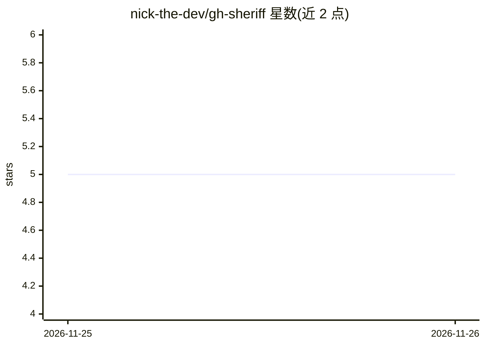

# nick-the-dev/gh-sheriff

⭐ 5 · Python · MIT · 推送 2026-11-25 · [GitHub](https://github.com/nick-the-dev/gh-sheriff) · 个人维护

**用 AI 在 CI 中审查 AI 代理提交的 PR，通过后才放行合并**

一个 GitHub CLI 扩展，面向由 AI 代理开启 pull request 的仓库：一条命令安装后，在 CI 中对每次 push 执行 AI 审查（可选便宜模型先审、通过后再由高配模型复审），并创建 ruleset 阻止未通过审查的合并（含管理员）。附带任务规划（在 issue 上生成七段式计划）、任务状态看板、每 PR 3+3 次审查次数限制、部署健康检查与合并模式配置。完全构建于 GitHub Actions、GitHub App、rulesets、Issues 与 Projects 之上。当前为 Beta，行为可能随更新变化。

## 筛选速览

| 维度 | 判定 | 备注 |
|---|---|---|
| AI 角色 | `ai-native` | 本体是模型或模型工具 |
| 许可风险 | `permissive` | MIT |
| 部署形态 | `None` |  |
| 模型依赖 | locked-api |  |
| 硬件要求 | — | 无带数字的原话,不猜 |
| 安装摩擦 | `low` | 无编译、无系统依赖或容器化 |
| 成熟度 | `idea` | |

## 能力要点

- 两级模型审查管线：SHERIFF_FIRST_PASS 便宜模型先行，通过后由高配模型复审
- ruleset 合并门禁：审查未通过即阻止合并，管理员也不例外
- 任务规划：在 issue 上生成含优先级、方案、测试与生产验证的七段计划，PR 审查对照计划版本
- 依赖 GitHub Actions/App/rulesets/Projects，兼容任意代理工具

## 适用场景

- 管理多个 AI 编码代理提交 PR 的仓库合并质量
- 为代理任务自动生成计划并按计划核对实现
- 用 merge gate 防止未审查代码直接进入默认分支

## 场景标签

`代码审查` · 领域:编码与开发

## 证据(README 行号)

> L5:  A GitHub CLI extension that reviews every pull request with AI in CI,
> L16: Sheriff is for repositories where AI agents open pull requests. One command sets up:
> L19: - an AI review on every push: an optional cheap model first, and a smart model only if that passes;

## 星数曲线

2026-11-25 5 → 2026-11-26 5（+0）

---
*卡片 v1 · prompt 1.4 · 生成 2026-11-24 · 置信度 high · 依据 README sha `584b19d351e2` · [字段定义](../../DATASET.md)*
