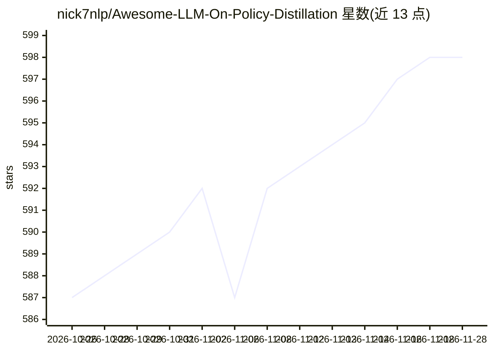

# nick7nlp/Awesome-LLM-On-Policy-Distillation

⭐ 598 · Python · MIT · 推送 2026-11-27 · [GitHub](https://github.com/nick7nlp/Awesome-LLM-On-Policy-Distillation) · [官网](https://nick7nlp.github.io/OPDHub/) · 个人维护

**LLM 在线策略蒸馏论文资源清单（397 条，附综述）**

配套综述《A Survey of On-Policy Distillation for Large Language Models》的论文策展清单，收录 397 条条目（144 条附代码），按目标函数与更新规则、监督来源、多智能体学习等主题组织，并提供按问题出发的阅读路径。每条含日期、方法类别与摘要式总结，支持在关联站点 OPDHub 上检索过滤。以 GitHub Pages 与仓库形式提供，面向 LLM 蒸馏方向的研究者。

## 筛选速览

| 维度 | 判定 | 备注 |
|---|---|---|
| AI 角色 | `ai-knowledge` | 知识聚合/清单类 |
| 许可风险 | `permissive` | MIT |
| 部署形态 | `None` |  |
| 模型依赖 | — | README 未给出锁定关系 |
| 硬件要求 | — | 无带数字的原话,不猜 |
| 安装摩擦 | `low` | 无编译、无系统依赖或容器化 |
| 成熟度 | — | 结构信号不足 |

## 能力要点

- 397 条论文条目，144 条附代码链接
- 按主题分类组织并标注方法类别（Direct/Hybrid OPD 等）
- 提供多条引导式阅读路径（采样、监督来源、迁移、多智能体）
- 关联 OPDHub 检索站点支持搜索过滤

## 适用场景

- 为蒸馏方向论文调研查找入门文献与阅读顺序
- 寻找带开源实现的在线策略蒸馏方法
- 跟踪该领域最新论文动态

## 场景标签

`精选清单` · 领域:学习与行业

## 证据(README 行号)

> L3:  Awesome LLM On-Policy Distillation — learning from teachers on the student’s own trajectories.
> L9:  397 entries · 144 with code · Updated&nbsp;2026&#8209;11&#8209;27
> L11: A reading companion to **A Survey of On-Policy Distillation for Large Language Models**.

## 星数曲线

2026-10-26 587 → 2026-11-28 598（+11）

---
*卡片 v1 · prompt 1.4 · 生成 2026-11-28 · 置信度 high · 依据 README sha `c085c5cdb674` · [字段定义](../../DATASET.md)*
