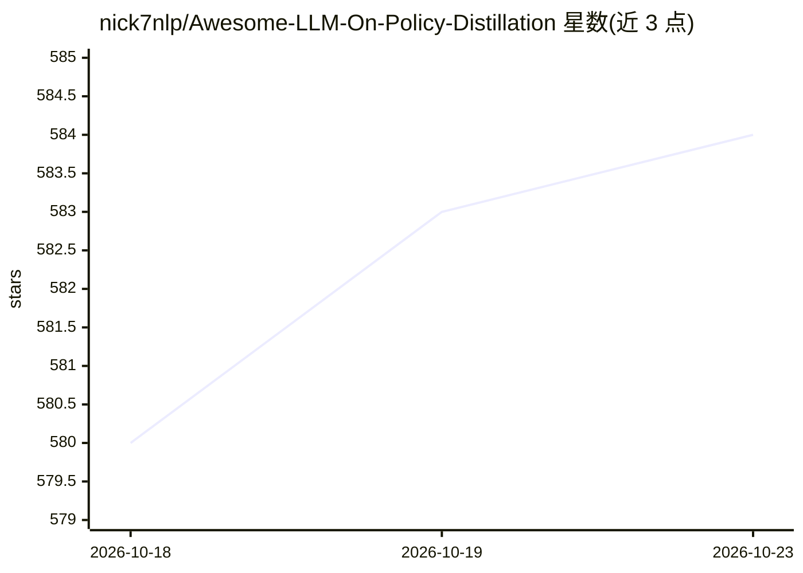

# nick7nlp/Awesome-LLM-On-Policy-Distillation

⭐ 584 · Python · MIT · 推送 2026-10-13 · [GitHub](https://github.com/nick7nlp/Awesome-LLM-On-Policy-Distillation) · [官网](https://nick7nlp.github.io/OPDHub/) · 个人维护

**LLM 在线策略蒸馏（OPD）论文与资源策展清单**

作为《A Survey of On-Policy Distillation for Large Language Models》的阅读伴侣，收录 362 个条目（其中 134 个附带代码），按主题组织并提供 OPDHub 站点检索。条目按 Objectives and update rules 等主题分类，每条含论文日期、方法分类（Direct OPD/Hybrid OPD/Teacher-mediated RL 等）与摘要说明，另提供按问题（如何学习、监督来源等）的阅读路径。面向 LLM 训练与蒸馏方向的研究者。README 未提供本清单的安装命令。

## 筛选速览

| 维度 | 判定 | 备注 |
|---|---|---|
| AI 角色 | `ai-knowledge` | 知识聚合/清单类 |
| 许可风险 | `permissive` | MIT |
| 部署形态 | `None` |  |
| 模型依赖 | — | README 未给出锁定关系 |
| 硬件要求 | — | 无带数字的原话,不猜 |
| 安装摩擦 | `low` | 无编译、无系统依赖或容器化 |
| 成熟度 | — | 结构信号不足 |

## 能力要点

- 362 条论文条目，134 条附带代码
- 配套 OPDHub 网站支持检索与筛选
- 按研究问题组织的阅读路径（学习机制/监督来源/迁移性/多智能体）
- 条目按方法类型标注（Direct OPD / Hybrid OPD / Teacher-mediated RL / Analysis）

## 适用场景

- 系统性地跟踪在线策略蒸馏方向的最新论文
- 按研究问题查找入门阅读路径
- 筛选附带代码的实现以便复现

## 场景标签

`精选清单` · 领域:学习与行业

## 证据(README 行号)

> L9:  362 entries · 134 with code · Updated&nbsp;2026&#8209;10&#8209;13
> L11: A reading companion to **A Survey of On-Policy Distillation for Large Language Models**.

## 星数曲线

2026-10-18 580 → 2026-10-23 584（+4）

---
*卡片 v1 · prompt 1.4 · 生成 2026-10-22 · 置信度 high · 依据 README sha `6b837b3e3fef` · [字段定义](../../DATASET.md)*
