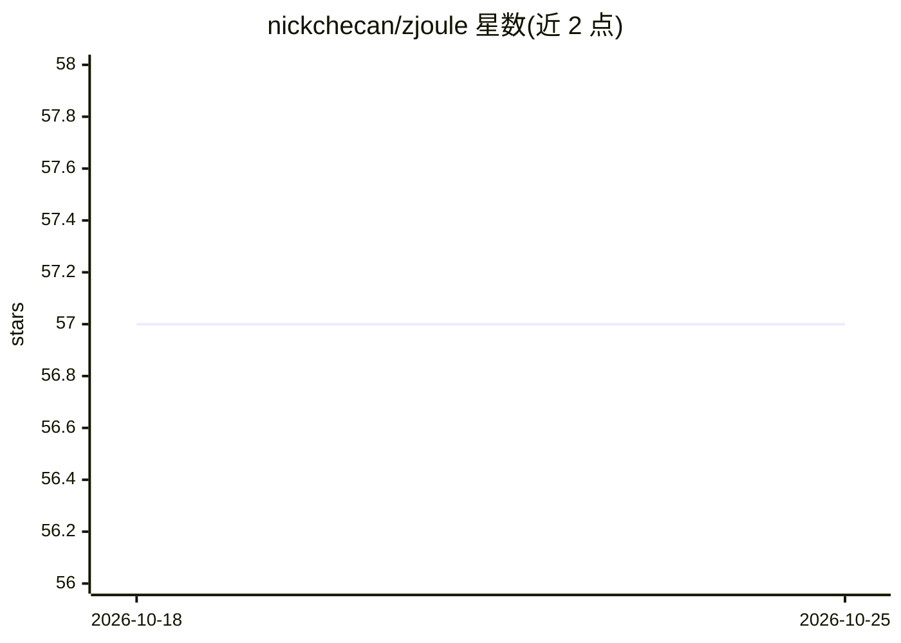

# nickchecan/zjoule

⭐ 57 · Java · MIT · 推送 2026-10-18 · [GitHub](https://github.com/nickchecan/zjoule) · 个人维护

**给 ABAP 开发者的 Eclipse AI 助手插件，接入 Ollama/SAP AI Core**

面向使用 Eclipse ADT 的 ABAP 开发者的开源 AI 聊天助手插件，通过本地 Ollama 或 SAP AI Core Generative AI Hub 接入 LLM，在 Eclipse 内提供编码问答、代码解释、错误分析与测试建议等能力；打开类或 CDS 视图时自动将其内容作为提问上下文。官方 Joule for ADT 仅面向 S/4HANA Private Cloud 与 BTP ABAP Environment，本插件面向其他 SAP 系统类型。需 Eclipse 2024-09 及以上；README 声明仓库正经历重要变更，期间插件不可用。

## 筛选速览

| 维度 | 判定 | 备注 |
|---|---|---|
| AI 角色 | `ai-native` | 本体是模型或模型工具 |
| 许可风险 | `permissive` | MIT |
| 部署形态 | `None` |  |
| 模型依赖 | local-ok | 支持本地模型 |
| 硬件要求 | — | 无带数字的原话,不猜 |
| 安装摩擦 | `low` | 无编译、无系统依赖或容器化 |
| 成熟度 | `idea` | |

## 能力要点

- 支持本地 Ollama 与 SAP AI Core Generative AI Hub 两种接入方式
- 打开类/CDS 视图时自动将组件内容纳入提问上下文
- 兼容 gpt-35-turbo、gpt-4 等 Azure OpenAI 模型（部分 Claude/GPT-4o 列为开发中）
- 可清除聊天历史，登出时擦除历史与登录数据

## 适用场景

- 在 Eclipse ADT 中直接向 AI 提问 ABAP 编码问题
- 调试时让 AI 分析错误信息并给出修复建议
- 本地 Ollama 环境下处理代码而不联网

## 场景标签

`AI 助手` · 领域:对话与助手

## 证据(README 行号)

> L13: **zJoule** is an Open Source AI assistant plugin for Eclipse designed to integrate Generative AI into your developm
> L61: The official Joule version for ADT is being rolled out exclusively for S/4HANA Private Cloud and SAP BTP, ABAP Envi

## 星数曲线

2026-10-18 57 → 2026-10-25 57（+0）

---
*卡片 v1 · prompt 1.4 · 生成 2026-10-24 · 置信度 high · 依据 README sha `3e6b96f6c861` · [字段定义](../../DATASET.md)*
